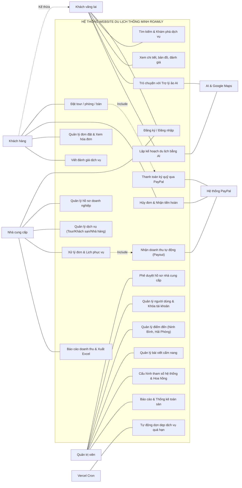
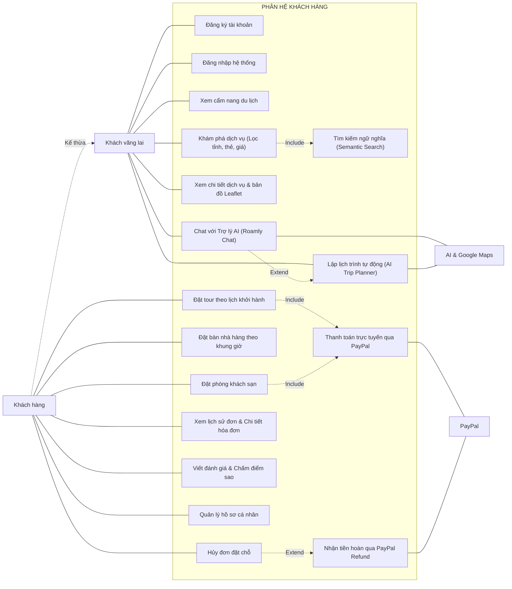
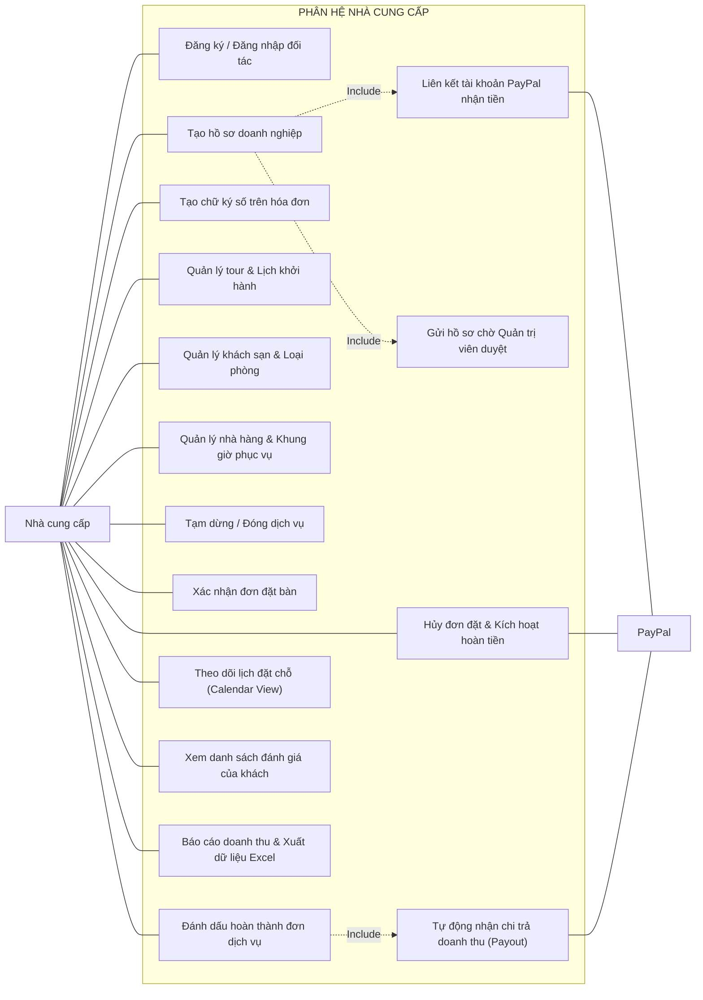
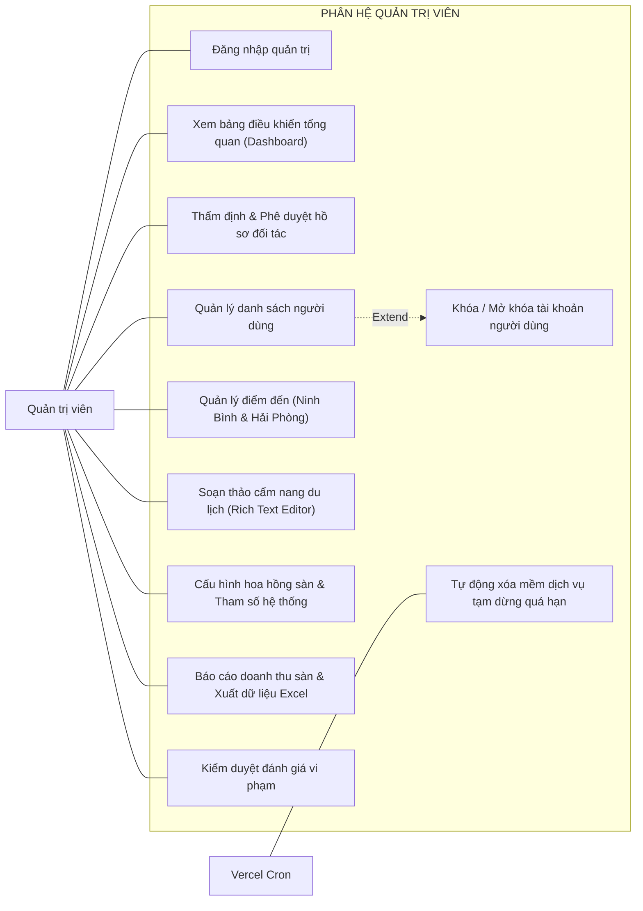
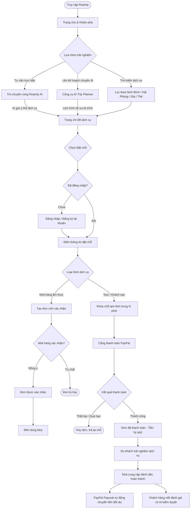

# BÁO CÁO ĐỒ ÁN TỐT NGHIỆP

**ĐỀ TÀI:**  
### NGHIÊN CỨU VÀ PHÁT TRIỂN HỆ THỐNG WEBSITE DU LỊCH THÔNG MINH TÍCH HỢP TRÍ TUỆ NHÂN TẠO (AI)

---

## LỜI CẢM ƠN

Lời đầu tiên, em xin gửi lời cảm ơn chân thành tới Ban Giám hiệu **Trường Đại học Phenikaa** cùng toàn thể quý Thầy Cô giáo trong **Khoa Công nghệ Thông tin** đã tận tình giảng dạy, truyền đạt những tri thức quý báu và tạo điều kiện thuận lợi cho em trong suốt quá trình học tập tại trường.

Đặc biệt, em xin bày tỏ lòng biết ơn sâu sắc nhất tới **Thầy/Cô Nguyễn Văn A** – Giảng viên hướng dẫn trực tiếp. Thầy/Cô đã luôn dành thời gian định hướng, tận tình chỉ bảo chuyên môn và hỗ trợ em trong suốt quá trình nghiên cứu, triển khai và hoàn thành đồ án tốt nghiệp.

Em cũng xin cảm ơn gia đình và bạn bè đã luôn đồng hành, động viên em. Dù đã nỗ lực hoàn thiện đề tài, đồ án khó tránh khỏi những thiếu sót, em rất mong nhận được ý kiến đóng góp quý báu từ quý Thầy Cô.

*Em xin chân thành cảm ơn!*

---

## TÓM TẮT ĐỒ ÁN TỐT NGHIỆP

Đồ án hướng tới xây dựng một hệ thống website du lịch thông minh toàn diện, giúp kết nối khách hàng với các nhà cung cấp dịch vụ du lịch (tour, phòng khách sạn, nhà hàng) và tối ưu hóa toàn bộ trải nghiệm chuyến đi trên một nền tảng thống nhất. Trong bối cảnh ngành du lịch chuyển đổi số mạnh mẽ, việc người dùng phải tra cứu, đối chiếu thông tin qua nhiều kênh rời rạc (từ lịch trình tham quan, phòng lưu trú đến ẩm thực) thường làm dữ liệu bị phân tán, tốn nhiều thời gian chuẩn bị và thiếu khả năng hỗ trợ tức thời theo nhu cầu cá nhân. Đồng thời, các đơn vị cung cấp dịch vụ cũng gặp khó khăn trong việc quản lý tập trung đơn đặt, tiếp cận khách hàng tiềm năng và theo dõi hiệu quả kinh doanh. Vì vậy, hệ thống được nghiên cứu và phát triển nhằm tập trung hóa chuỗi cung ứng dịch vụ du lịch, giảm thiểu các thao tác thủ công và mang lại trải nghiệm lập kế hoạch, đặt chỗ liền mạch, trực quan cho người dùng.

Hệ thống hỗ trợ đầy đủ các nghiệp vụ thực tế cho ba nhóm tác nhân chính: Khách hàng, Nhà cung cấp dịch vụ và Quản trị viên hệ thống. Khách hàng có thể tìm kiếm thông minh theo địa điểm, ngân sách, thời gian, sở thích; xem bản đồ vị trí, hình ảnh thực tế và đặt chỗ đa dịch vụ kèm thanh toán trực tuyến an toàn qua PayPal với cơ chế ký quỹ, hoàn tiền và chi trả doanh thu tự động (Payouts). Do giới hạn thời gian thu thập dữ liệu, hệ thống tập trung xây dựng cơ sở dữ liệu dịch vụ chuyên sâu tại 2 địa phương du lịch tiêu biểu là Ninh Bình và Hải Phòng. Nhà cung cấp được cung cấp phân hệ quản lý hồ sơ doanh nghiệp, quản trị danh mục dịch vụ, lịch khởi hành/phòng/bàn, theo dõi lịch đặt và báo cáo doanh thu. Quản trị viên kiểm soát quy trình xét duyệt nhà cung cấp, kiểm duyệt nội dung, quản lý điểm đến và giám sát toàn bộ hoạt động sàn thương mại điện tử. Điểm nổi bật của đề tài là việc tích hợp sâu các công nghệ Trí tuệ nhân tạo (AI) hiện đại, bao gồm: trợ lý ảo Chatbot AI tư vấn du lịch thời gian thực theo ngữ cảnh ứng dụng kỹ thuật RAG (Retrieval-Augmented Generation) kết hợp mô hình ngôn ngữ lớn (LLM); hệ thống lập lịch trình thông minh cá nhân hóa (AI Trip Planner) tự động đề xuất lộ trình và tối ưu hóa quãng đường di chuyển dựa trên Google Routes API; cùng cơ chế AI phân tích ngữ nghĩa để tự động kiểm duyệt nội dung đánh giá và phát hiện spam.

Về mặt công nghệ, hệ thống được kiến trúc theo mô hình Full-stack hiện đại với framework Next.js 16 (App Router, Server Actions, React 19, TypeScript), kết hợp cơ sở dữ liệu quan hệ PostgreSQL thông qua Prisma ORM đảm bảo tính toàn vẹn dữ liệu giao dịch. Khả năng tìm kiếm ngữ nghĩa và lưu trữ vector phục vụ RAG được đảm nhiệm bởi Pinecone Vector Database kết hợp mô hình nhúng Gemini Embedding. Phân hệ trí tuệ nhân tạo được xây dựng trên nền tảng Vercel AI SDK và Google Gemini trên Google Cloud Vertex AI, kết hợp Google Places và Routes API để xử lý thông tin địa điểm và bản đồ số thực tế. Toàn bộ các tương tác và độ trễ của mô hình AI được giám sát, truy vết chi tiết thông qua hệ thống Langfuse (OpenTelemetry). Việc phân tách kiến trúc module hóa rõ ràng theo chuẩn Feature/Entity giúp hệ thống đạt độ tin cậy cao, dễ bảo trì, mở rộng và sẵn sàng phục vụ lượng truy cập lớn.

Kết quả của đồ án đã xây dựng thành công một sản phẩm website du lịch thông minh hoàn chỉnh, có tính ứng dụng cao và giao diện thân thiện với người dùng. Đề tài không chỉ giải quyết bài toán số hóa quy trình kinh doanh dịch vụ du lịch truyền thống mà còn minh chứng cho tiềm năng to lớn của việc ứng dụng Trí tuệ nhân tạo thế hệ mới (Generative AI, RAG, Semantic Search) vào việc nâng tầm trải nghiệm du khách. Đồng thời, đề tài thể hiện việc vận dụng chuyên sâu các kiến thức về phân tích yêu cầu, thiết kế hệ thống, phát triển phần mềm, tích hợp mô hình AI và tổ chức dữ liệu vào một bài toán thực tế.

---

## DANH MỤC CÁC TỪ VIẾT TẮT

> **Quy định sử dụng viết tắt:** Báo cáo chỉ sử dụng các từ viết tắt được liệt kê chính thức trong bảng danh mục dưới đây. Tất cả các thuật ngữ chuyên môn hoặc khái niệm khác không có trong danh mục này đều được viết đầy đủ nhằm đảm bảo tính chuẩn mực, trong sáng và tính nhất quán của đồ án tốt nghiệp.

| STT | Từ viết tắt | Thuật ngữ tiếng Anh (Đầy đủ) | Ý nghĩa / Giải thích tiếng Việt |
|:---:|:---|:---|:---|
| 1 | **AI** | Artificial Intelligence | Trí tuệ nhân tạo |
| 2 | **API** | Application Programming Interface | Giao diện lập trình ứng dụng |
| 3 | **CDN** | Content Delivery Network | Mạng phân phối nội dung |
| 4 | **CSDL** | Cơ sở dữ liệu | Hệ thống lưu trữ dữ liệu có cấu trúc (Database) |
| 5 | **CNTT** | Công nghệ thông tin | Ngành khoa học công nghệ thông tin |
| 6 | **ERD** | Entity-Relationship Diagram | Sơ đồ quan hệ thực thể |
| 7 | **FIT** | Free Independent Traveler | Khách du lịch tự túc / tự do |
| 8 | **GIS** | Geographic Information System | Hệ thống thông tin địa lý |
| 9 | **GMV** | Gross Merchandise Volume | Tổng giá trị giao dịch hàng hóa trên sàn |
| 10 | **HTTP / HTTPS** | HyperText Transfer Protocol (Secure) | Giao thức truyền tải siêu văn bản (bảo mật) |
| 11 | **ISR** | Incremental Static Regeneration | Cơ chế tái tạo trang tĩnh gia tăng |
| 12 | **JSON** | JavaScript Object Notation | Định dạng chuẩn trao đổi dữ liệu dạng văn bản |
| 13 | **JWT** | JSON Web Token | Chuỗi mã hóa dữ liệu phục vụ xác thực người dùng |
| 14 | **LLM** | Large Language Model | Mô hình ngôn ngữ lớn |
| 15 | **NLP** | Natural Language Processing | Xử lý ngôn ngữ tự nhiên |
| 16 | **ORM** | Object-Relational Mapping | Kỹ thuật ánh xạ đối tượng - cơ sở dữ liệu quan hệ |
| 17 | **OTA** | Online Travel Agent | Đại lý du lịch trực tuyến |
| 18 | **RAG** | Retrieval-Augmented Generation | Kỹ thuật tăng cường truy xuất thông tin cho mô hình AI tạo sinh |
| 19 | **RBAC** | Role-Based Access Control | Cơ chế kiểm soát truy cập dựa trên vai trò |
| 20 | **RDBMS** | Relational Database Management System | Hệ quản trị cơ sở dữ liệu quan hệ |
| 21 | **REST** | Representational State Transfer | Kiểu kiến trúc truyền tải trạng thái cho dịch vụ web (RESTful) |
| 22 | **SEO** | Search Engine Optimization | Tối ưu hóa công cụ tìm kiếm |
| 23 | **SMEs** | Small and Medium-sized Enterprises | Doanh nghiệp có quy mô vừa và nhỏ |
| 24 | **SSR** | Server-Side Rendering | Cơ chế kết xuất giao diện phía máy chủ |
| 25 | **UI** | User Interface | Giao diện người dùng |
| 26 | **UX** | User Experience | Trải nghiệm người dùng |

---

# CHƯƠNG 1: GIỚI THIỆU ĐỀ TÀI

## 1.1. Đặt vấn đề

### 1.1.1. Bối cảnh thực tiễn ngành du lịch trong kỷ nguyên số
Trong tiến trình phát triển kinh tế - xã hội hiện đại, du lịch được xác định là một trong những ngành kinh tế mũi nhọn, đóng góp tỷ trọng lớn vào Tổng sản phẩm quốc nội (GDP) của nhiều quốc gia, trong đó có Việt Nam. Cùng với sự bùng nổ của hạ tầng Internet tốc độ cao, thiết bị di động thông minh và các dịch vụ thanh toán không tiền mặt, hành vi của du khách đã có sự chuyển biến mang tính căn bản. Khái niệm du lịch truyền thống – vốn gắn liền với các đoàn tour khép kín có lịch trình cố định sẵn – đang dần nhường chỗ cho xu hướng du lịch tự túc (Free Independent Traveler – FIT) và du lịch trải nghiệm cá nhân hóa. Ngày nay, du khách đề cao sự chủ động, mong muốn tự do khám phá các điểm đến độc đáo, thưởng thức ẩm thực bản địa và điều chỉnh kế hoạch chuyến đi linh hoạt theo sở thích, thời gian và khả năng tài chính riêng của bản thân hoặc gia đình.

Song hành cùng xu hướng đó, làn sóng chuyển đổi số quốc gia đang thúc đẩy mạnh mẽ quá trình hình thành hệ sinh thái **Du lịch thông minh (Smart Tourism)**. Chính phủ và các cơ quan quản lý du lịch đã ban hành nhiều đề án nhằm đẩy mạnh ứng dụng công nghệ thông tin vào việc xúc tiến, quảng bá điểm đến, hỗ trợ du khách và số hóa hoạt động kinh doanh lữ hành. Nhu cầu về các nền tảng số có khả năng cung cấp thông tin toàn diện, minh bạch và hỗ trợ người dùng từ khâu chuẩn bị, trải nghiệm cho đến khi kết thúc chuyến đi ngày càng trở nên cấp bách.

### 1.1.2. Những bất cập và nút thắt trong các giải pháp hiện tại
Mặc dù thị trường đã xuất hiện nhiều ứng dụng và trang web dịch vụ du lịch trực tuyến (Online Travel Agent – OTA), cả người tiêu dùng lẫn các đơn vị kinh doanh dịch vụ du lịch hiện nay vẫn đang đối mặt với nhiều bất cập và khó khăn chưa được giải quyết triệt để:

1. **Sự phân mảnh dữ liệu và hiện tượng quá tải nhận thức (Cognitive Overload):**  
   Để chuẩn bị cho một chuyến du lịch trọn vẹn, du khách thường phải trải qua quy trình tra cứu phức tạp, rời rạc trên nhiều nền tảng khác nhau: đọc bài viết chia sẻ kinh nghiệm trên mạng xã hội hoặc diễn đàn, tìm và đặt phòng lưu trú trên các trang OTA quốc tế, tìm kiếm tour trải nghiệm trên các trang lữ hành nội địa, và tự tra cứu quán ăn, phương tiện đi lại qua các ứng dụng bản đồ. Việc dữ liệu bị phân tán khiến người dùng phải mở hàng chục tab trình duyệt, đối chiếu thông tin thủ công, tốn nhiều giờ hoặc thậm chí nhiều ngày để tổng hợp chi phí và lịch trình.

2. **Nghịch lý trong bài toán lập kế hoạch chuyến đi (Itinerary Planning Problem):**  
   Về bản chất khoa học máy tính, việc lập kế hoạch du lịch là một bài toán tối ưu hóa đa mục tiêu kết hợp (Multi-objective Combinatorial Optimization) vô cùng phức tạp. Người dùng phải cân đối đồng thời giữa: thời gian hoạt động của các điểm tham quan, khoảng cách địa lý thực tế giữa các điểm dừng, phương tiện di chuyển, ngân sách dự kiến, và thể lực cũng như thói quen sinh hoạt của từng thành viên trong đoàn. Khi thực hiện thủ công, du khách rất dễ sắp xếp lịch trình không hợp lý (ví dụ: các điểm đến quá xa nhau, di chuyển lòng vòng gây lãng phí thời gian và nhiên liệu, hoặc lịch trình quá dày đặc gây kiệt sức).

3. **Hạn chế cố hữu của các hệ thống OTA truyền thống:**  
   Đa số các trang web du lịch hiện nay vẫn dựa trên phương pháp tìm kiếm từ khóa chính xác và các bộ lọc phân cấp tĩnh (Faceted Search: lọc theo giá, số sao, quận/huyện). Cơ chế này không thể xử lý được các nhu cầu mang tính ngữ cảnh phức tạp của con người (ví dụ: *"Tôi muốn tìm một homestay gần biển ở Đà Nẵng, không gian yên tĩnh để làm việc từ xa, có bếp nấu ăn cho gia đình và giá dưới 1 triệu/đêm"*). Du khách hoàn toàn thiếu đi một công cụ hỗ trợ đối thoại tự nhiên, có khả năng lắng nghe, thấu hiểu ngữ cảnh và đưa ra gợi ý phù hợp như một chuyên gia tư vấn lữ hành thực thụ.

4. **Rào cản công nghệ đối với các nhà cung cấp dịch vụ địa phương (SMEs):**  
   Các doanh nghiệp du lịch vừa và nhỏ, hợp tác xã lữ hành địa phương, các chủ homestay hay quán ăn truyền thống thường gặp khó khăn trong việc tiếp cận các nền tảng thương mại điện tử lớn do chi phí hoa hồng cao, quy trình xét duyệt phức tạp và thiếu công cụ quản lý số hóa tinh gọn. Họ thiếu một nền tảng chuyên biệt giúp đăng bán sản phẩm, theo dõi tình trạng đơn đặt theo thời gian thực (calendar view), và quản lý doanh thu minh bạch.

5. **Vấn nạn thao túng đánh giá và bình luận rác (Fake Reviews & Spam):**  
   Đánh giá của người dùng là yếu tố quyết định tới hơn 85% hành vi đặt dịch vụ. Tuy nhiên, tình trạng các bài đánh giá ảo, bình luận rác, nội dung quảng cáo không đúng sự thật hoặc các lời lẽ tiêu cực mang tính cạnh tranh không lành mạnh đang diễn ra phổ biến. Các hệ thống hiện hành thiếu bộ lọc ngữ nghĩa thông minh để tự động phân tích và kiểm soát chất lượng nội dung đánh giá trước khi công bố.

### 1.1.3. Cơ hội từ Trí tuệ nhân tạo (AI) và tính cấp thiết của đề tài
Trong hai năm trở lại đây, sự bứt phá của **Trí tuệ nhân tạo tạo sinh (Generative AI)**, đặc biệt là các **Mô hình ngôn ngữ lớn (LLM)** thế hệ mới kết hợp với kỹ thuật **Tăng cường truy xuất thông tin (Retrieval-Augmented Generation – RAG)** và **Cơ sở dữ liệu Vector (Vector Database)**, đã tạo ra một bước ngoặt công nghệ chưa từng có. AI ngày nay không chỉ có khả năng hiểu sâu ngôn ngữ tự nhiên, ghi nhớ ngữ cảnh hội thoại mà còn có thể tương tác với các hệ thống bên ngoài thông qua cơ chế gọi công cụ (Function Calling / Tool Calling).

Khi kết hợp năng lực suy luận của AI với dữ liệu bản đồ số không gian thời gian thực (Geospatial & Routing APIs) và hệ cơ sở dữ liệu quan hệ chặt chẽ, ta hoàn toàn có thể xây dựng một hệ thống website du lịch thế hệ mới: nơi du khách vừa có thể trò chuyện tự nhiên với trợ lý ảo để được tư vấn dịch vụ, tự động sinh lịch trình tối ưu quãng đường di chuyển trên bản đồ, vừa có thể tiến hành đặt tour, phòng khách sạn, bàn nhà hàng và thanh toán trực tuyến trong một trải nghiệm duy nhất.

Xuất phát từ những phân tích thực tiễn và cơ sở công nghệ trên, đề tài **"Nghiên cứu và phát triển hệ thống website du lịch thông minh tích hợp Trí tuệ nhân tạo (AI)"** (với sản phẩm phần mềm mang thương hiệu **Roamly**) được lựa chọn thực hiện nhằm mang lại một giải pháp công nghệ toàn diện, thiết thực và có giá trị ứng dụng cao cho ngành du lịch số.

---

## 1.2. Mục tiêu và phạm vi nghiên cứu

### 1.2.1. Mục tiêu của đề tài

* **Mục tiêu chung:**  
  Nghiên cứu, làm chủ các kỹ thuật Trí tuệ nhân tạo hiện đại (LLM, RAG, Semantic Vector Search, NLP Content Moderation) kết hợp với các dịch vụ bản đồ số (Google Places, Google Routes); từ đó thiết kế, phát triển và triển khai thử nghiệm hoàn chỉnh hệ thống website du lịch thông minh **Roamly** trên môi trường thực tế, đáp ứng đầy đủ chu trình nghiệp vụ của một sàn thương mại điện tử du lịch tích hợp trợ lý ảo cá nhân hóa.

* **Mục tiêu cụ thể:**
  1. *Về phương diện nghiên cứu khoa học và công nghệ:*
     - Nghiên cứu cơ chế vận hành của mô hình ngôn ngữ lớn (Google Gemini 2.5 Flash trên nền tảng đám mây Google Cloud Vertex AI) và giải pháp xây dựng Prompt Engineering tối ưu cho bài toán du lịch.
     - Nghiên cứu và hiện thực hóa kiến trúc **RAG (Retrieval-Augmented Generation)**: neo tri thức của mô hình vào cơ sở dữ liệu thực tế của hệ thống và API ngoại vi, triệt tiêu hiện tượng mô hình tự sinh thông tin sai lệch (hallucination).
     - Nghiên cứu kỹ thuật biểu diễn ngữ nghĩa của văn bản thành vector đặc trưng nhiều chiều (Vector Embeddings) và cơ chế tìm kiếm độ tương đồng Cosine Similarity trên cơ sở dữ liệu vector chuyên dụng **Pinecone**.
     - Nghiên cứu mô hình toán học và giải pháp tính toán ma trận khoảng cách, thời gian di chuyển thực tế từ Google Routes API để tự động sắp xếp các điểm tham quan theo lộ trình tối ưu nhất.
     - Nghiên cứu ứng dụng xử lý ngôn ngữ tự nhiên (NLP) nhằm phân tích cảm xúc (Sentiment Analysis), phát hiện và phân loại tự động các nội dung đánh giá vi phạm, độc hại hoặc spam.

  2. *Về phương diện kỹ thuật phần mềm và phát triển hệ thống:*
     - Thiết kế kiến trúc phần mềm Full-stack hiện đại, tuân thủ nguyên lý thiết kế phân lớp (Clean Architecture / Feature-driven Architecture) với **Next.js 16 (App Router, Server Actions, React 19, TypeScript)**.
     - Thiết kế và chuẩn hóa cơ sở dữ liệu quan hệ **PostgreSQL** thông qua **Prisma ORM 7**, đảm bảo tính toàn vẹn dữ liệu giao dịch (ACID) cho các luồng đặt chỗ phức tạp.
     - Xây dựng hệ thống phân quyền kiểm soát truy cập dựa trên vai trò (Role-Based Access Control – RBAC) bảo mật tuyệt đối cho 3 nhóm đối tượng: Khách hàng (Customer), Nhà cung cấp dịch vụ (Provider) và Quản trị viên (Admin).
     - Hiện thực hóa đầy đủ chuỗi nghiệp vụ đặt chỗ đa dịch vụ: Tour du lịch (theo lịch khởi hành), Cơ sở lưu trú (theo loại phòng và ngày check-in/out), và Nhà hàng ẩm thực (theo khung giờ và sức chứa).
     - Tích hợp cổng thanh toán trực tuyến quốc tế **PayPal** theo mô hình ký quỹ an toàn (Escrow), tự động hóa quy trình thanh toán giữ chỗ, xuất hóa đơn điện tử, hủy đơn hoàn tiền và chi trả doanh thu (Payouts) cho đối tác sau khi trừ hoa hồng sàn.
     - Xây dựng phân hệ Lập kế hoạch chuyến đi thông minh (**AI Trip Planner**) với giao diện tương tác trực quan, kết xuất lịch trình chi tiết và trực quan hóa tuyến đường di chuyển trên bản đồ Leaflet / Google Maps.
     - Xây dựng hệ thống báo cáo thống kê chuyên sâu với biểu đồ trực quan hóa doanh thu, đơn hàng (ApexCharts) và hỗ trợ xuất dữ liệu định dạng chuẩn Microsoft Excel (`.xlsx`).
     - Tích hợp nền tảng quan sát và đánh giá chất lượng mô hình AI (**Langfuse**) theo chuẩn OpenTelemetry để theo dõi thời gian đáp ứng (latency), lượng token tiêu thụ và độ chính xác của các phiên gọi công cụ (tool call).

### 1.2.2. Đối tượng và phạm vi nghiên cứu

* **Đối tượng nghiên cứu:**  
  - Các kỹ thuật Trí tuệ nhân tạo thế hệ mới: Large Language Models (LLM), Retrieval-Augmented Generation (RAG), Vector Embeddings, Semantic Search.
  - Các dịch vụ nền tảng số: Google Maps Platform (Places API, Routes API), Cổng thanh toán quốc tế PayPal REST API, CSDL quan hệ PostgreSQL, CSDL vector Pinecone, và hạ tầng CDN ImageKit.
  - Quy trình nghiệp vụ sàn thương mại điện tử du lịch trực tuyến: Quản lý danh mục sản phẩm, đặt chỗ đa dịch vụ, quản trị đơn hàng, ký quỹ - quyết toán tài chính và kiểm duyệt nội dung cộng đồng.

* **Phạm vi không gian và dữ liệu:**  
  - Trong khuôn khổ thời gian thực hiện đồ án tốt nghiệp, việc thu thập, chuẩn hóa và xác thực dữ liệu chi tiết (tọa độ GPS, hình ảnh bản quyền, khung giá, chính sách phòng/vé/bàn) trên phạm vi toàn quốc gặp nhiều thách thức lớn về mặt thời gian và nguồn lực. Do đó, **đề tài chủ động lựa chọn tập trung nghiên cứu và xây dựng bộ dữ liệu chuyên sâu cho 2 tỉnh/thành phố trọng điểm đại diện cho hai loại hình du lịch đặc trưng tại miền Bắc**:
    1. **Ninh Bình:** Đại diện cho loại hình du lịch di sản văn hóa, tâm linh và sinh thái cảnh quan (Quần thể danh thắng Tràng An, Cố đô Hoa Lư, Tam Cốc - Bích Động, Chùa Bái Đính...).
    2. **Hải Phòng:** Đại diện cho loại hình du lịch biển đảo, nghỉ dưỡng và khám phá ẩm thực đô thị đặc sắc (Quần đảo Cát Bà, Vịnh Lan Hạ, Bãi biển Đồ Sơn và tuyến du lịch ẩm thực Food Tour Hải Phòng).
  - Dữ liệu dịch vụ tại 2 địa phương này bao gồm: Các tour du lịch lữ hành, cơ sở lưu trú (khách sạn/homestay/resort), nhà hàng ẩm thực địa phương và các bài viết cẩm nang hướng dẫn trải nghiệm.

* **Phạm vi người dùng:**  
  - Phục vụ đồng thời 3 nhóm tác nhân trong cùng một hệ sinh thái web: Du khách (người dùng cuối), Doanh nghiệp/Chủ cơ sở cung cấp dịch vụ, và Đội ngũ quản trị viên vận hành sàn.

* **Giới hạn của đề tài:**  
  - Hệ thống được triển khai thử nghiệm trên môi trường Web ứng dụng công nghệ Responsive Web Design, tương thích hiển thị trên cả trình duyệt máy tính và điện thoại thông minh; đề tài không xây dựng ứng dụng di động độc lập (Native Mobile App trên iOS/Android).
  - Về giải pháp thanh toán: Hệ thống tập trung tích hợp và chuẩn hóa quy trình giao dịch qua cổng thanh toán quốc tế **PayPal**, tận dụng tính năng **PayPal Payouts** phục vụ mô hình sàn thương mại điện tử trung gian, chưa mở rộng sang các cổng thanh toán nội địa.
  - Dữ liệu địa điểm và tuyến đường di chuyển trong phân hệ AI Trip Planner được đồng bộ thông qua API chính thống của Google Maps và Google Routes với phạm vi dữ liệu giao thông đường bộ hiện hành.

---

## 1.3. Định hướng giải pháp

Để giải quyết một cách triệt để các thách thức trong bài toán đặt ra, đề tài đề xuất và triển khai 5 định hướng giải pháp kỹ thuật và nghiệp vụ chủ đạo:

### 1.3.1. Hợp nhất chuỗi cung ứng dịch vụ du lịch trên nền tảng thương mại điện tử đa chiều
Thay vì phân tán người dùng qua các dịch vụ riêng lẻ, hệ thống được thiết kế theo mô hình nền tảng đa bên (Multi-sided Platform) khép kín:
- **Khách hàng** được cung cấp một "trạm dừng chân một điểm" (One-stop Platform): từ lúc tìm kiếm nguồn cảm hứng, đọc cẩm nang kinh nghiệm, trò chuyện với trợ lý AI, thiết lập lịch trình cá nhân hóa, đến khi trực tiếp đặt vé tour, đặt phòng khách sạn, giữ bàn nhà hàng và thanh toán trực tuyến an toàn.
- **Nhà cung cấp** sở hữu một phân hệ quản trị chuyên biệt (Provider Portal) với đầy đủ công cụ để quản lý thông tin doanh nghiệp, đăng tải các dịch vụ với các thuộc tính linh hoạt (giá vé người lớn/trẻ em, số đêm phòng, ca phục vụ nhà hàng), theo dõi tiến độ đơn hàng và xem lịch phục vụ trực quan.
- **Quản trị viên** nắm giữ quyền kiểm soát tối cao thông qua Admin Dashboard: thẩm định giấy phép và hồ sơ của đối tác, phê duyệt bài viết, kiểm duyệt đánh giá và điều phối chính sách hoa hồng sàn (`PLATFORM_COMMISSION_RATE`).

### 1.3.2. Kiến trúc AI có neo dữ liệu thực tế và gọi công cụ thời gian thực (Grounded RAG)
Nhằm khắc phục hoàn toàn nhược điểm tự tạo thông tin giả (hallucination) thường gặp ở các mô hình ngôn ngữ lớn, đề tài áp dụng kiến trúc **RAG kết hợp Function Calling / Tool Calling**:
- Khi người dùng gửi câu hỏi tới Trợ lý ảo (Roamly AI), mô hình ngôn ngữ lớn (Gemini 2.5 Flash) không tự suy diễn nội dung mà phân tích ý định (Intent Recognition) để kích hoạt các "công cụ" (Tools) đã được lập trình sẵn.
- Hệ thống cung cấp các công cụ truy vấn dữ liệu thời gian thực: công cụ tìm kiếm tour, khách sạn trong CSDL PostgreSQL; công cụ tìm kiếm ngữ nghĩa theo vector qua Pinecone; và công cụ truy vấn thông tin địa điểm thực tế qua Google Places API.
- Mô hình AI nhận kết quả JSON trả về từ các công cụ, tổng hợp lại thành văn bản đối thoại tự nhiên, đồng thời trả về các thành phần giao diện động (UI Cards) chứa đầy đủ hình ảnh, giá cả, đánh giá sao để người dùng có thể nhấp chuột vào xem chi tiết hoặc đặt chỗ ngay trong luồng hội thoại.

### 1.3.3. Lập lịch trình thông minh kết hợp mô hình AI và API bản đồ số (Hybrid AI-GIS Routing)
Giải quyết bài toán lập kế hoạch chuyến đi bằng sự kết hợp hài hòa giữa trí tuệ nhân tạo và hệ thống thông tin địa lý (GIS):
- **Tầng AI (Ngữ nghĩa & Thói quen):** Phân tích các tiêu chí đầu vào của du khách (thời lượng, ngân sách, thành phần đoàn du lịch, sở thích) để lựa chọn danh sách các điểm tham quan tương thích, phân bổ hợp lý vào các khung thời gian trong ngày (Buổi sáng: tham quan văn hóa/di tích; Buổi trưa: thưởng thức ẩm thực bản địa; Buổi chiều: vui chơi/biển đảo; Buổi tối: chợ đêm/nghỉ ngơi).
- **Tầng GIS (Toán học & Địa lý):** Tích hợp **Google Routes API** để tính toán khoảng cách vật lý (km) và thời gian di chuyển dự kiến giữa các điểm dừng chân liên tiếp; vẽ đường đi thực tế (polyline) trực quan trên bản đồ tương tác. Cơ chế này đảm bảo lịch trình sinh ra có tính khả thi cao nhất, loại bỏ hoàn toàn tình trạng di chuyển lòng vòng, chéo cung đường.

### 1.3.4. Kiểm duyệt nội dung đánh giá đa tầng bằng Trí tuệ nhân tạo
Nhằm bảo vệ tính minh bạch và uy tín của sàn, hệ thống xây dựng quy trình kiểm duyệt nội dung đánh giá kết hợp:
- **Tầng quy tắc cứng (Rule-based Filtering):** Kiểm tra quyền đánh giá (chỉ khách hàng đã hoàn thành đơn đặt dịch vụ thực tế mới được quyền viết đánh giá), phát hiện các từ khóa vi phạm tiêu chuẩn cộng đồng.
- **Tầng phân tích ngữ nghĩa AI (Semantic AI Moderation):** Sử dụng mô hình ngôn ngữ để phân tích ngữ cảnh của bài đánh giá, tự động phát hiện các nội dung mang tính chất quảng cáo rác (spam links), ngôn từ kích động bạo lực, xúc phạm danh dự hoặc đánh giá có dấu hiệu tiêu cực bất thường. Các trường hợp nghi vấn sẽ tự động được gắn cờ cảnh báo (Flagged) để Quản trị viên xử lý, ngăn chặn việc hiển thị công khai trên giao diện.

### 1.3.5. Cơ chế ký quỹ thanh toán an toàn và quyết toán tự động qua PayPal Payouts
Trong mô hình kinh doanh sàn thương mại điện tử đa bên (Multi-sided Platform), luồng tài chính đòi hỏi giải quyết đồng thời hai chiều giao dịch: thu tiền từ khách hàng khi đặt chỗ (Pay-in) và giải ngân chi trả doanh thu cho nhà cung cấp dịch vụ sau khi dịch vụ hoàn tất (Payout). 

Hầu hết các cổng thanh toán nội địa tại Việt Nam hiện nay chủ yếu hỗ trợ chiều thu tiền (C2B) và quy trình cấp quyền API chi trả tự động hàng loạt (B2C/B2B Payouts) đòi hỏi hồ sơ doanh nghiệp pháp nhân lớn cùng các thỏa thuận ngân hàng phức tạp, khó khả thi trong khuôn khổ một đề tài tốt nghiệp của sinh viên. Do đó, **cổng thanh toán PayPal được lựa chọn làm giải pháp cốt lõi cho hệ thống nhờ sở hữu tính năng PayPal Payouts API**:
- **Ký quỹ bảo vệ dòng tiền (Escrow):** Toàn bộ số tiền thanh toán khi khách hàng đặt chỗ được giữ an toàn tại tài khoản trung gian của sàn Roamly, đảm bảo quyền lợi cho khách hàng.
- **Tự động hóa hoàn tiền (Automated Refund):** Khách hàng được quyền hủy đơn và nhận tiền hoàn tự động trực tiếp về tài khoản PayPal nếu việc hủy tuân thủ đúng chính sách thời hạn hủy của dịch vụ.
- **Tự động chi trả doanh thu qua PayPal Payouts:** Sau khi khách hàng sử dụng dịch vụ thành công và đơn hàng được chuyển sang trạng thái Hoàn thành (`COMPLETED`), hệ thống sẽ tự động kích hoạt API **PayPal Payouts** để giải ngân doanh thu thực nhận (sau khi đã tự động khấu trừ tỷ lệ hoa hồng của sàn) chuyển thẳng về tài khoản PayPal mà nhà cung cấp đã liên kết trong hồ sơ doanh nghiệp. Cơ chế này loại bỏ hoàn toàn các thao tác đối soát và chuyển khoản thủ công, đảm bảo tính minh bạch, chính xác tuyệt đối.

---

## 1.4. Bố cục của Đồ án

Báo cáo đồ án tốt nghiệp được trình bày khoa học, mạch lạc thành 6 chương với cấu trúc nội dung chi tiết như sau:

* **Chương 1: Giới thiệu đề tài**  
  Trình bày bức tranh tổng quan về bối cảnh chuyển đổi số ngành du lịch, nêu bật tính cấp thiết của đề tài; phân tích những bất cập, hạn chế của các giải pháp hiện hành; xác định rõ mục tiêu nghiên cứu (về mặt học thuật và phát triển hệ thống), đối tượng, phạm vi và giới hạn của đề tài; đề xuất các định hướng giải pháp kỹ thuật cốt lõi và giới thiệu bố cục của toàn bộ báo cáo.

* **Chương 2: Phân tích nghiệp vụ và yêu cầu hệ thống**  
  Khảo sát và mô tả chi tiết vai trò của 3 nhóm tác nhân (Khách hàng, Nhà cung cấp, Quản trị viên); phân tích toàn diện các yêu cầu chức năng cho từng phân hệ và các yêu cầu phi chức năng (về mặt hiệu năng, bảo mật, độ tin cậy, giao diện); xây dựng sơ đồ ca sử dụng tổng quan và chi tiết (Use Case Diagram); mô tả các luồng quy trình nghiệp vụ cốt lõi (đặt tour, đặt phòng, đặt bàn, luồng thanh toán ký quỹ và quyết toán doanh thu).

* **Chương 3: Thiết kế kiến trúc hệ thống và cơ sở dữ liệu**  
  Trình bày chi tiết kiến trúc phân tầng tổng thể của hệ thống (Presentation, Application, Business Domain, Data & Integration Layer); thiết kế mô hình cơ sở dữ liệu quan hệ (ERD) với PostgreSQL và chuẩn hóa thông qua Prisma ORM; thiết kế cấu trúc dữ liệu vector trên Pinecone phục vụ tìm kiếm ngữ nghĩa; xây dựng mô hình bảo mật, cơ chế xác thực JWT và kiểm soát phân quyền truy cập đa cấp (RBAC) với Auth.js.

* **Chương 4: Nghiên cứu và ứng dụng Trí tuệ nhân tạo (AI)**  
  Tập trung nghiên cứu sâu về mặt lý thuyết và hiện thực hóa các giải pháp AI trong hệ thống: thiết kế kiến trúc Trợ lý ảo Roamly AI theo mô hình RAG kết hợp Function Calling; xây dựng hệ thống tìm kiếm ngữ nghĩa (Semantic Search) bằng Vector Embeddings; hiện thực hóa thuật toán lập lịch trình cá nhân hóa và tối ưu hóa tuyến đường (AI Trip Planner) kết hợp Google Routes API; cơ chế phân tích và kiểm duyệt nội dung đánh giá tự động; và giải pháp quan sát, truy vết chất lượng mô hình AI với Langfuse Tracing.

* **Chương 5: Hiện thực hóa và đánh giá kết quả thực nghiệm**  
  Giới thiệu môi trường công nghệ, công cụ phát triển và kiến trúc mã nguồn dự án; trình bày chi tiết kết quả xây dựng các giao diện, màn hình chức năng chính của cả 3 phân hệ (Customer, Provider, Admin); báo cáo kết quả kiểm thử chức năng (Functional Testing), kiểm thử hiệu năng tải trang (Lighthouse / Performance) và đánh giá độ chính xác, độ tin cậy của các tính năng AI trong môi trường vận hành thực tế.

* **Chương 6: Kết luận và hướng phát triển**  
  Tổng kết toàn bộ các kết quả chính đã hoàn thành của đồ án; đối chiếu với các mục tiêu ban đầu đề ra; thẳng thắn chỉ ra những điểm còn tồn tại, hạn chế của hệ thống; và đề xuất các định hướng nghiên cứu, cải tiến công nghệ và mở rộng tính năng trong tương lai (tích hợp thanh toán nội địa, phát triển ứng dụng di động, mở rộng mô hình AI đa phương thức Multimodal AI).

---

# CHƯƠNG 2: KHẢO SÁT VÀ PHÂN TÍCH YÊU CẦU

## 2.1. Khảo sát hiện trạng

### 2.1.1. Khảo sát các nền tảng công nghệ du lịch hiện có
Trong bối cảnh thị trường du lịch trực tuyến phát triển mạnh mẽ, các giải pháp công nghệ phục vụ du khách và doanh nghiệp lữ hành có thể được phân loại thành hai nhóm chính: các đại lý du lịch trực tuyến truyền thống (OTA) và các ứng dụng thử nghiệm ứng dụng Trí tuệ nhân tạo (AI).

1. **Các nền tảng OTA truyền thống (Booking.com, Agoda, Klook, Traveloka):**
   - *Ưu điểm:* Cơ sở dữ liệu phong phú, quy mô toàn cầu; quy trình đặt chỗ và thanh toán thẻ tín dụng chuẩn hóa; giao diện người dùng (UI) quen thuộc; hệ thống đánh giá số lượng lớn.
   - *Hạn chế:*
     + Phương thức tìm kiếm phụ thuộc hoàn toàn vào các bộ lọc tĩnh (Faceted Search: lọc theo khoảng giá, số sao, quận/huyện) và từ khóa chính xác. Người dùng không thể tìm kiếm theo ngữ cảnh phức tạp hoặc mô tả tự nhiên.
     + Thiếu khả năng lập kế hoạch và lịch trình tổng thể: Người dùng phải tự chọn từng dịch vụ đơn lẻ và tự lắp ghép lịch trình thủ công bên ngoài hệ thống.
     + Mức chiết khấu hoa hồng sàn cao (thường từ 15% đến 25%), gây áp lực tài chính lớn cho các doanh nghiệp vừa và nhỏ (SMEs).
     + Thiếu công cụ hỗ trợ tư vấn tức thời mang tính cá nhân hóa; các chatbot chăm sóc khách hàng chủ yếu là kịch bản cây quyết định tĩnh (Rule-based Chatbot) với câu trả lời định sẵn, không hiểu được nhu cầu sâu xa của du khách.

2. **Các ứng dụng Trí tuệ nhân tạo hỗ trợ du lịch sơ khai (ChatGPT, RoamAround, Tripnotes):**
   - *Ưu điểm:* Khả năng sinh ngôn ngữ tự nhiên mượt mà; tốc độ phản hồi nhanh; gợi ý được các ý tưởng du lịch phong phú.
   - *Hạn chế:*
     + Thường xuyên gặp hiện tượng thông tin ảo tưởng (hallucination) do mô hình ngôn ngữ lớn (LLM) không được neo dữ liệu thực tế (grounding) vào kho dịch vụ lữ hành có thật. Mô hình có thể gợi ý các quán ăn đã đóng cửa, khách sạn không còn hoạt động hoặc giá vé sai lệch hoàn toàn.
     + Hoàn toàn tách rời với nghiệp vụ thương mại điện tử: Người dùng chỉ xem được văn bản gợi ý, không thể tiến hành đặt chỗ (booking) hay thanh toán trực tiếp.
     + Không tối ưu hóa được quãng đường và thời gian di chuyển thực tế theo điều kiện giao thông đường bộ do thiếu sự liên kết với các giao diện lập trình ứng dụng (API) bản đồ chuyên nghiệp.

#### Bảng so sánh đối chuẩn giữa Roamly và các giải pháp hiện tại:

| Tiêu chí so sánh | Nền tảng OTA (Booking/Klook) | Trợ lý AI tổng quát (ChatGPT) | Hệ thống Roamly |
|---|:---:|:---:|:---:|
| **Tìm kiếm ngữ nghĩa (Semantic Search)** | ❌ Chỉ lọc thuộc tính cứng | ⚠️ Không có CSDL dịch vụ | ✅ Vector Search (Pinecone) |
| **Trợ lý ảo tư vấn theo ngữ cảnh (RAG)** | ❌ Chatbot kịch bản tĩnh | ⚠️ Dễ bị ảo tưởng (Hallucination) | ✅ Grounded RAG + Live Tools |
| **Lập lịch trình tối ưu lộ trình (GIS)** | ❌ Không hỗ trợ | ⚠️ Chỉ sinh văn bản ước tính | ✅ Tích hợp Google Routes API |
| **Đa dạng hóa dịch vụ lữ hành** | ⚠️ Tách rời từng ứng dụng | ❌ Không hỗ trợ | ✅ Tour, Khách sạn, Bàn nhà hàng |
| **Kiểm duyệt đánh giá tự động (NLP)** | ⚠️ Lọc từ khóa thô sơ | ❌ Không áp dụng | ✅ Phân tích ngữ nghĩa AI |
| **Tự động chi trả đối tác (Payout)** | ⚠️ Đối soát thủ công định kỳ | ❌ Không có nghiệp vụ | ✅ Tự động qua PayPal Payouts |

---

### 2.1.2. Khảo sát thực trạng tại hai địa bàn trọng điểm: Ninh Bình và Hải Phòng
Nhằm đảm bảo tính khả thi cao trong thời gian thực hiện đồ án tốt nghiệp, đề tài tập trung thu thập, số hóa và xác thực dữ liệu tại hai địa phương tiêu biểu của khu vực phía Bắc:

1. **Tỉnh Ninh Bình (Trọng điểm du lịch di sản văn hóa và danh thắng sinh thái):**
   - *Đặc điểm du lịch:* Sở hữu Di sản Văn hóa và Thiên nhiên Thế giới Quần thể danh thắng Tràng An, Cố đô Hoa Lư, Tam Cốc - Bích Động, Chùa Bái Đính, Hang Múa, Đầm Vân Long.
   - *Khảo sát nhu cầu khách du lịch (FIT):* Phần lớn du khách lựa chọn chuyến đi ngắn ngày (1 đến 2 ngày). Du khách có nhu cầu cao về việc sắp xếp thứ tự tham quan hợp lý (ví dụ: đi thuyền Tràng An vào buổi sáng khi trời mát, leo Hang Múa ngắm hoàng hôn vào buổi chiều), kết hợp đặt phòng homestay sinh thái và thưởng thức đặc sản dê núi, cơm cháy.
   - *Khảo sát thực trạng nhà cung cấp:* Các cơ sở lưu trú và nhà hàng tại Ninh Bình đa phần là doanh nghiệp gia đình hoặc hợp tác xã quy mô nhỏ. Việc nhận khách chủ yếu qua điện thoại hoặc tin nhắn mạng xã hội, dẫn đến tình trạng ghi chép sổ sách thủ công, dễ trùng lịch hoặc sót đơn vào các mùa cao điểm lễ hội.

2. **Thành phố Hải Phòng (Trọng điểm du lịch biển đảo và ẩm thực đô thị):**
   - *Đặc điểm du lịch:* Nổi tiếng với Quần đảo Cát Bà, Vịnh Lan Hạ, Bãi biển Đồ Sơn, và đặc biệt là trào lưu du lịch ẩm thực (Food Tour Hải Phòng) thu hút đông đảo giới trẻ.
   - *Khảo sát nhu cầu khách du lịch:* Du khách đến Cát Bà có nhu cầu đặt tour vịnh, chèo thuyền kayak, thuê phòng khách sạn ven biển; trong khi du khách đi Food Tour trong nội thành lại có nhu cầu tìm kiếm các quán ăn lâu đời, uy tín (bánh đa cua, bánh mì cay, chè dừa dầm) và đặt bàn trước theo khung giờ để tránh việc phải xếp hàng chờ đợi lâu.
   - *Khảo sát thực trạng nhà cung cấp:* Các nhà hàng đặc sản nội thành thường xuyên rơi vào tình trạng quá tải vào khung giờ trưa và tối các ngày cuối tuần nhưng chưa có công cụ quản lý khung giờ và sức chứa phục vụ một cách chuyên nghiệp.

---

### 2.1.3. Khảo sát quy trình thanh toán trung gian và lý do lựa chọn PayPal
Mô hình sàn thương mại điện tử du lịch đặt ra một thách thức lớn về mặt tài chính:
- Khách hàng thanh toán tiền khi đặt chỗ (Pay-in) $\rightarrow$ Tiền phải được ký quỹ an toàn trên sàn $\rightarrow$ Sau khi du khách sử dụng dịch vụ thành công, sàn mới tiến hành giải ngân chi trả doanh thu cho nhà cung cấp (Payout).
- Nếu chuyến đi bị hủy hợp lệ theo chính sách, hệ thống phải tự động hoàn tiền (Refund) cho khách hàng.

Qua khảo sát các cổng thanh toán tại thị trường Việt Nam:
- Các cổng thanh toán nội địa (như VNPay, MoMo, ZaloPay, VietQR) hỗ trợ rất tốt chiều thu tiền của khách hàng cá nhân (C2B). Tuy nhiên, dịch vụ chi trả tự động qua giao diện lập trình ứng dụng (B2C/B2B Payout API) đòi hỏi hợp đồng pháp nhân doanh nghiệp lớn, ký quỹ ngân hàng nghiêm ngặt và quy trình kiểm duyệt phức tạp, không khả thi đối với một đề tài nghiên cứu học thuật của sinh viên.
- **Lý do lựa chọn cổng thanh toán PayPal:**
  1. Hỗ trợ trọn vẹn luồng giao dịch 2 chiều: Thu tiền qua **PayPal Orders API** và chi trả tự động qua **PayPal Payouts API**.
  2. Cung cấp sẵn cơ chế hoàn tiền tức thì qua **PayPal Refund API**.
  3. Cung cấp môi trường kiểm thử (Sandbox) hoàn chỉnh, cho phép giả lập tài khoản khách hàng, tài khoản sàn và ví đối tác nhà cung cấp với đầy đủ webhook thông báo giao dịch theo thời gian thực.
  4. Phù hợp với định hướng mở rộng phục vụ du khách quốc tế trong tương lai.

---

## 2.2. Tổng quan chức năng

### 2.2.1. Xác định các tác nhân hệ thống (Actors)
Hệ thống xác định 4 tác nhân con người và 3 tác nhân hệ thống bên ngoài:

| Tác nhân | Loại tác nhân | Mô tả vai trò |
|---|:---:|---|
| **Khách vãng lai (Guest)** | Người dùng | Người truy cập website chưa thực hiện đăng nhập: xem trang chủ, tìm kiếm dịch vụ, đọc bài viết cẩm nang, tương tác với trợ lý ảo AI, sử dụng công cụ lập lịch trình. |
| **Khách hàng (Customer)** | Người dùng | Người dùng đã đăng ký/đăng nhập tài khoản cá nhân: kế thừa toàn bộ quyền của Khách vãng lai; có quyền đặt tour, đặt phòng, đặt bàn, thanh toán qua PayPal, quản lý lịch sử đơn, hủy đơn và viết đánh giá. |
| **Nhà cung cấp (Provider)** | Người dùng | Đơn vị kinh doanh tour, khách sạn, nhà hàng: tạo hồ sơ doanh nghiệp (chờ duyệt), đăng tải và quản trị dịch vụ, theo dõi lịch phục vụ, xử lý đơn đặt, nhận doanh thu qua PayPal Payouts, xem báo cáo thống kê. |
| **Quản trị viên (Admin)** | Người dùng | Đơn vị quản trị vận hành sàn: phê duyệt hồ sơ đối tác, quản lý người dùng, quản trị điểm đến Ninh Bình và Hải Phòng, quản lý bài viết cẩm nang, cấu hình tham số hệ thống và theo dõi báo cáo doanh thu toàn sàn. |
| **Hệ thống PayPal** | Hệ thống ngoài | Xử lý thanh toán giữ chỗ, webhook thông báo trạng thái đơn hàng, hoàn tiền khi hủy đơn và tự động chi trả doanh thu cho nhà cung cấp qua PayPal Payouts. |
| **Mô hình AI & Dịch vụ Bản đồ** | Hệ thống ngoài | Google Gemini trên nền tảng Vertex AI xử lý hội thoại RAG và kiểm duyệt đánh giá; Pinecone xử lý tìm kiếm vector; Google Places và Routes API xử lý dữ liệu địa điểm và tối ưu hóa tuyến đường. |
| **Dịch vụ Vercel Cron** | Hệ thống ngoài | Tự động kích hoạt các tiến trình định kỳ phía máy chủ nhằm rà soát và xóa mềm các dịch vụ đã tạm dừng quá hạn quy định. |

---

### 2.2.2. Sơ đồ Use Case tổng quan của hệ thống

---

### 2.2.3. Phân rã Use Case theo từng phân hệ

#### A. Phân hệ Khách vãng lai và Khách hàng

#### B. Phân hệ Nhà cung cấp dịch vụ

#### C. Phân hệ Quản trị viên

---

### 2.2.4. Ma trận phân quyền người dùng (RBAC Matrix)

Nhằm đảm bảo an toàn dữ liệu và tuân thủ nguyên tắc đặc quyền tối thiểu, hệ thống áp dụng cơ chế phân quyền kiểm soát truy cập dựa trên vai trò (RBAC):

| Phân hệ / Tài nguyên chức năng | Khách vãng lai | Khách hàng (Customer) | Nhà cung cấp (Provider) | Quản trị viên (Admin) |
|---|:---:|:---:|:---:|:---:|
| **Xem dịch vụ, điểm đến, cẩm nang** | Xem (Read) | Xem (Read) | Xem (Read) | Quản trị toàn quyền |
| **Tìm kiếm ngữ nghĩa & Chat AI** | Thực thi (Execute) | Thực thi (Execute) | Thực thi (Execute) | Thực thi & Giám sát |
| **Lập lịch trình bằng AI (Trip Planner)** | Thực thi (Execute) | Thực thi (Execute) | Thực thi (Execute) | Thực thi (Execute) |
| **Đặt chỗ (Tour/Phòng/Bàn)** | Không | Tạo mới (Create) | Không | Xem & Giám sát |
| **Thanh toán trực tuyến & Hủy đơn** | Không | Thực thi (Execute) | Không | Xem & Giám sát |
| **Xem & in hóa đơn điện tử** | Không | Đơn của bản thân | Đơn của cơ sở mình | Xem tất cả hóa đơn |
| **Viết đánh giá dịch vụ** | Không | Đơn đã hoàn thành | Phản hồi đánh giá | Kiểm duyệt & Ẩn/Xóa |
| **Quản trị dịch vụ (Đăng/Sửa/Đóng)** | Không | Không | Dịch vụ của bản thân | Kiểm duyệt & Xóa mềm |
| **Xác nhận bàn & Hoàn thành đơn** | Không | Không | Đơn của cơ sở mình | Can thiệp khi tranh chấp |
| **Phê duyệt hồ sơ đối tác kinh doanh** | Không | Không | Tạo & Gửi duyệt | Toàn quyền phê duyệt |
| **Quản trị người dùng & Khóa tài khoản** | Không | Không | Không | Toàn quyền kiểm soát |
| **Cấu hình tham số sàn & Hoa hồng** | Không | Không | Không | Toàn quyền cấu hình |

---

### 2.2.5. Biểu đồ luồng trải nghiệm người dùng tổng thể (User Journey Flow)

---

## 2.3. Đặc tả chức năng chi tiết

### 2.3.1. Đặc tả các Use Case thuộc phân hệ Khách hàng

#### UC-01: Tìm kiếm và khám phá dịch vụ thông minh
- **Mã Use Case:** UC-01
- **Tác nhân:** Khách vãng lai, Khách hàng.
- **Mục đích:** Hỗ trợ người dùng tra cứu tour, khách sạn, nhà hàng tại Ninh Bình và Hải Phòng thông qua bộ lọc đa thuộc tính hoặc tìm kiếm bằng ngôn ngữ tự nhiên.
- **Tiền điều kiện:** Người dùng truy cập trang Khám phá (`/explore`).
- **Luồng sự kiện chính:**
  1. Người dùng chọn tab loại dịch vụ mong muốn (Tour, Khách sạn, Nhà hàng).
  2. Người dùng chọn địa bàn (Ninh Bình hoặc Hải Phòng), chọn khoảng giá, số sao đánh giá hoặc các thẻ phong cách (nghỉ dưỡng, di sản, ẩm thực, biển đảo).
  3. Hoặc người dùng nhập câu mô tả tự nhiên vào thanh tìm kiếm (ví dụ: *"khách sạn view biển Cát Bà giá dưới 1 triệu"*).
  4. Hệ thống thực hiện nhúng câu hỏi thành vector đặc trưng và truy vấn cơ sở dữ liệu vector Pinecone kết hợp lọc thuộc tính trên PostgreSQL.
  5. Hệ thống hiển thị danh sách kết quả phù hợp kèm hình ảnh, mức giá, số sao và vị trí trên bản đồ Leaflet.
- **Luồng ngoại lệ:** Nếu không tìm thấy dịch vụ nào khớp hoàn toàn với câu hỏi ngữ nghĩa, hệ thống tự động mở rộng vùng tìm kiếm sang các điểm lân cận cùng tỉnh và đưa ra gợi ý liên quan.
- **Hậu điều kiện:** Người dùng có thể nhấp chọn dịch vụ để xem chi tiết.

#### UC-02: Trò chuyện và tư vấn với Trợ lý ảo AI (Roamly Chat)
- **Mã Use Case:** UC-02
- **Tác nhân:** Khách vãng lai, Khách hàng, Mô hình AI (Gemini 2.5 Flash trên Vertex AI), CSDL Vector Pinecone, Google Places API.
- **Mục đích:** Tư vấn dịch vụ du lịch, giải đáp thắc mắc và gợi ý địa điểm theo ngữ cảnh thời gian thực.
- **Tiền điều kiện:** Người dùng mở giao diện chat (`/chat`).
- **Luồng sự kiện chính:**
  1. Người dùng nhập câu hỏi hoặc yêu cầu tư vấn du lịch.
  2. Hệ thống chuyển tin nhắn đến mô hình ngôn ngữ lớn thông qua kiến trúc RAG.
  3. Mô hình phân tích ý định và kích hoạt các công cụ tương ứng:
     - Nếu hỏi về tour: Gọi công cụ `searchTours` để tra cứu trong cơ sở dữ liệu nội bộ qua Pinecone và PostgreSQL.
     - Nếu hỏi về địa điểm ăn uống, vui chơi lân cận: Gọi công cụ `searchPlaces` để tra cứu địa điểm thực tế từ Google Places API.
     - Nếu câu hỏi còn mơ hồ về địa danh: Kích hoạt công cụ `askUser` để hỏi lại du khách.
  4. Mô hình tổng hợp thông tin và phản hồi dạng dòng (Streaming Response).
  5. Giao diện hiển thị văn bản trả lời đính kèm các thẻ dịch vụ động (UI Cards) có nút xem chi tiết và đặt chỗ ngay.
- **Luồng ngoại lệ:** Nếu kết nối tới mạng đám mây Vertex AI bị gián đoạn, hệ thống thông báo lỗi thân thiện và gợi ý người dùng sử dụng bộ lọc tìm kiếm truyền thống.
- **Hậu điều kiện:** Người dùng nhận được câu trả lời chính xác, được neo với dữ liệu thực tế và có thể tương tác tiếp.

#### UC-03: Lập kế hoạch du lịch bằng AI (AI Trip Planner)
- **Mã Use Case:** UC-03
- **Tác nhân:** Khách vãng lai, Khách hàng, Mô hình AI, Google Routes API.
- **Mục đích:** Tự động thiết kế lịch trình du lịch cá nhân hóa nhiều ngày tại Ninh Bình hoặc Hải Phòng và tối ưu hóa tuyến đường di chuyển thực tế.
- **Tiền điều kiện:** Người dùng truy cập phân hệ Lập kế hoạch (`/trip-planner`).
- **Luồng sự kiện chính:**
  1. Người dùng cung cấp các thông tin đầu vào: Điểm đến (Ninh Bình hoặc Hải Phòng), số lượng ngày, ngân sách dự kiến, thành phần đoàn đi và sở thích trải nghiệm.
  2. Mô hình AI phân tích dữ liệu, lựa chọn các điểm tham quan phù hợp và phân chia khoa học vào các khung giờ: Sáng, Trưa, Chiều, Tối của từng ngày.
  3. Hệ thống gửi tọa độ các điểm dừng chân liên tiếp tới Google Routes API để tính toán ma trận khoảng cách vật lý (km) và thời gian di chuyển dự kiến.
  4. Hệ thống kết xuất lịch trình chi tiết theo từng ngày, trực quan hóa toàn bộ lộ trình di chuyển (polyline) trên bản đồ tương tác.
- **Luồng ngoại lệ:** Nếu điểm đến người dùng nhập nằm ngoài phạm vi 2 tỉnh Ninh Bình và Hải Phòng, hệ thống thông báo phạm vi dữ liệu hiện tại và gợi ý lịch trình khám phá một trong hai địa phương trên.
- **Hậu điều kiện:** Lịch trình được lưu lại trên trình duyệt của người dùng; người dùng có thể tùy chỉnh hoặc liên kết đặt các dịch vụ xuất hiện trong lịch trình.

#### UC-04: Đặt chỗ và thanh toán ký quỹ qua PayPal
- **Mã Use Case:** UC-04
- **Tác nhân:** Khách hàng, Hệ thống PayPal.
- **Mục đích:** Thực hiện quy trình đặt tour, phòng khách sạn và thanh toán trực tuyến ký quỹ an toàn.
- **Tiền điều kiện:** Khách hàng đã đăng nhập; dịch vụ còn chỗ trống/phòng trống khả dụng.
- **Luồng sự kiện chính:**
  1. Khách hàng chọn ngày khởi hành (đối với Tour) hoặc ngày check-in/check-out (đối với Khách sạn), chọn số lượng vé hoặc loại phòng.
  2. Khách hàng nhập thông tin liên hệ và nhấn "Tiến hành đặt chỗ".
  3. Hệ thống tạo bản ghi đơn đặt ở trạng thái chờ thanh toán (`pending_payment`) và tạm khóa số lượng chỗ/phòng trong khoảng thời gian quy định (`bookingHoldMinutes`).
  4. Hệ thống tự động quy đổi giá trị đơn hàng từ Việt Nam Đồng sang Đô la Mỹ theo tỷ giá niêm yết và khởi tạo giao dịch qua PayPal Orders API.
  5. Khách hàng đăng nhập ví PayPal hoặc sử dụng thẻ thanh toán quốc tế để xác thực giao dịch trên cổng PayPal an toàn.
  6. Sau khi thanh toán thành công, PayPal gửi tín hiệu xác nhận về hệ thống. Hệ thống chuyển trạng thái đơn hàng sang Đã thanh toán (`paid`), tạo bản ghi thanh toán và cấp mã hóa đơn điện tử cho khách hàng.
- **Luồng ngoại lệ:** Nếu khách hàng không hoàn tất thanh toán trong thời gian giữ chỗ (`bookingHoldMinutes`), hệ thống tự động hủy đơn và giải phóng số lượng chỗ/phòng về trạng thái sẵn sàng cho người khác đặt.
- **Hậu điều kiện:** Đơn hàng được xác nhận thanh toán; tiền được lưu giữ an toàn tại tài khoản ký quỹ của sàn.

#### UC-05: Hủy đơn và nhận hoàn tiền tự động qua PayPal Refund
- **Mã Use Case:** UC-05
- **Tác nhân:** Khách hàng, Hệ thống PayPal.
- **Mục đích:** Cho phép khách hàng hủy đơn đã thanh toán và nhận lại tiền hoàn tự động nếu đáp ứng chính sách hủy.
- **Tiền điều kiện:** Đơn hàng ở trạng thái `paid` hoặc `confirmed`; thời điểm yêu cầu hủy phải trước thời hạn hủy tối thiểu do nhà cung cấp quy định.
- **Luồng sự kiện chính:**
  1. Khách hàng truy cập danh sách đơn đặt cá nhân (`/my-bookings`), chọn đơn hàng cần hủy và chọn "Yêu cầu hủy đơn".
  2. Hệ thống kiểm tra điều kiện thời gian hủy so với thời điểm diễn ra dịch vụ.
  3. Nếu hợp lệ, hệ thống cập nhật trạng thái đơn thành Đã hủy (`cancelled`).
  4. Hệ thống kích hoạt PayPal Refund API với mã giao dịch tương ứng để hoàn trả 100% số tiền về tài khoản PayPal của khách hàng.
  5. Hệ thống hoàn trả lại số chỗ/phòng trống vào quỹ dịch vụ của nhà cung cấp.
- **Luồng ngoại lệ:** Nếu yêu cầu hủy đơn rơi vào khoảng thời gian cận kề ngày khởi hành (vượt quá thời hạn cho phép hủy), hệ thống từ chối hoàn tiền và thông báo lý do theo đúng quy chế đặt chỗ.
- **Hậu điều kiện:** Khách hàng nhận lại tiền hoàn; đơn chuyển trạng thái hủy hoàn tất.

#### UC-06: Đánh giá dịch vụ và kiểm duyệt tự động
- **Mã Use Case:** UC-06
- **Tác nhân:** Khách hàng, Mô hình AI kiểm duyệt.
- **Mục đích:** Gửi nhận xét và xếp hạng chất lượng sau khi đã sử dụng dịch vụ thực tế.
- **Tiền điều kiện:** Khách hàng sở hữu đơn hàng đã chuyển sang trạng thái Hoàn thành (`completed`) và chưa từng đánh giá đơn hàng đó.
- **Luồng sự kiện chính:**
  1. Khách hàng chọn số sao đánh giá (từ 1 đến 5 sao) và viết nội dung phản hồi trải nghiệm.
  2. Khi nhấn gửi, hệ thống kích hoạt mô hình ngôn ngữ lớn phân tích ngữ nghĩa nội dung:
     - Kiểm tra từ ngữ thô tục, xúc phạm hoặc kích động thù địch.
     - Phát hiện các đường liên kết quảng cáo rác (spam links) hoặc nội dung không liên quan đến dịch vụ.
  3. Nếu nội dung trong sạch: Hệ thống lưu đánh giá, tự động tính toán lại điểm đánh giá trung bình (`ratingAvg`) và số lượt đánh giá (`reviewCount`) của dịch vụ.
  4. Nếu nội dung nghi vấn vi phạm: Đánh giá được lưu nhưng tự động gắn cờ cảnh báo (`isFlagged = true`) và ẩn khỏi trang chi tiết cho đến khi Quản trị viên thẩm định.
- **Hậu điều kiện:** Đánh giá hợp lệ được hiển thị công khai trên trang chi tiết dịch vụ.

---

### 2.3.2. Đặc tả các Use Case thuộc phân hệ Nhà cung cấp

#### UC-07: Đăng ký hồ sơ doanh nghiệp và liên kết PayPal Payout
- **Mã Use Case:** UC-07
- **Tác nhân:** Nhà cung cấp, Quản trị viên, Hệ thống PayPal.
- **Mục đích:** Thiết lập hồ sơ pháp lý đối tác kinh doanh và tài khoản nhận tiền doanh thu tự động.
- **Tiền điều kiện:** Nhà cung cấp đã đăng ký tài khoản với vai trò `provider`.
- **Luồng sự kiện chính:**
  1. Nhà cung cấp điền thông tin doanh nghiệp/cơ sở kinh doanh: Tên thương hiệu, mã số thuế/giấy phép kinh doanh, số điện thoại, địa chỉ hoạt động tại Ninh Bình hoặc Hải Phòng.
  2. Nhà cung cấp nhập địa chỉ email tài khoản PayPal hợp lệ dùng để nhận tiền giải ngân doanh thu.
  3. Nhà cung cấp sử dụng bảng vẽ chữ ký số (Signature Pad) để tạo chữ ký điện tử sẽ xuất hiện trên hóa đơn thanh toán gửi khách hàng.
  4. Nhà cung cấp nhấn "Gửi hồ sơ thẩm định". Hồ sơ chuyển sang trạng thái Chờ duyệt (`pending`).
- **Luồng ngoại lệ:** Nếu email PayPal không đúng định dạng hoặc trùng lặp với tài khoản đối tác khác, hệ thống cảnh báo và yêu cầu chỉnh sửa trước khi gửi duyệt.
- **Hậu điều kiện:** Hồ sơ được gửi lên danh sách chờ Quản trị viên xét duyệt.

#### UC-08: Quản lý danh mục dịch vụ (Tour, Khách sạn, Nhà hàng)
- **Mã Use Case:** UC-08
- **Tác nhân:** Nhà cung cấp.
- **Mục đích:** Đăng ký mới, chỉnh sửa thông tin hoặc tạm dừng kinh doanh các sản phẩm dịch vụ du lịch.
- **Tiền điều kiện:** Hồ sơ nhà cung cấp đã được Quản trị viên phê duyệt (`approved`).
- **Luồng sự kiện chính:**
  1. Nhà cung cấp chọn loại hình dịch vụ muốn quản lý: Tour du lịch, Khách sạn, hoặc Nhà hàng ẩm thực.
  2. Nhập các thông tin chi tiết: Tên dịch vụ, mô tả nổi bật, địa chỉ chính xác, tải lên hình ảnh chất lượng cao thông qua mạng phân phối nội dung CDN ImageKit.
  3. Cấu hình các thuộc tính nghiệp vụ đặc thù:
     - Đối với Tour: Thiết lập lịch khởi hành theo ngày, số lượng khách tối đa cho mỗi chuyến, giá vé người lớn và giá vé trẻ em.
     - Đối với Khách sạn: Thiết lập danh sách các loại phòng, diện tích, tiện ích đi kèm, sức chứa và đơn giá theo đêm.
     - Đối với Nhà hàng: Thiết lập các khung giờ phục vụ trong ngày (ví dụ: ca trưa 11:00–13:00, ca tối 18:00–20:00) và sức chứa tối đa theo từng ca.
  4. Hệ thống lưu trữ dữ liệu vào PostgreSQL và đồng bộ dữ liệu văn bản mô tả sang Pinecone Vector Database phục vụ tìm kiếm ngữ nghĩa.
- **Luồng ngoại lệ:** Nếu nhà cung cấp tạm dừng một dịch vụ mà vẫn còn các đơn đặt chỗ chưa diễn ra trong tương lai, hệ thống yêu cầu tiếp tục phục vụ các đơn đã thanh toán trước khi đóng hoàn toàn dịch vụ.
- **Hậu điều kiện:** Dịch vụ được công bố trực tuyến trên sàn để du khách tìm kiếm và đặt chỗ.

#### UC-09: Xử lý đơn đặt và tự động nhận doanh thu qua PayPal Payouts
- **Mã Use Case:** UC-09
- **Tác nhân:** Nhà cung cấp, Hệ thống PayPal.
- **Mục đích:** Quản lý vòng đời đơn đặt và nhận tiền quyết toán doanh thu tự động vào ví PayPal.
- **Tiền điều kiện:** Có đơn đặt dịch vụ của khách hàng.
- **Luồng sự kiện chính:**
  1. Đối với dịch vụ đặt bàn nhà hàng: Nhà cung cấp xem thông tin đơn (`pending_confirmation`), kiểm tra sức chứa và nhấn "Xác nhận" (`confirmed`) hoặc "Từ chối" (`cancelled`).
  2. Đối với đơn tour hoặc khách sạn đã thanh toán (`paid`): Nhà cung cấp kiểm tra lịch phục vụ và đón tiếp khách hàng vào ngày hẹn.
  3. Sau khi du khách đã sử dụng xong dịch vụ, nhà cung cấp truy cập chi tiết đơn hàng và nhấn "Đánh dấu hoàn thành" (`completed`).
  4. Hệ thống tự động tính toán số tiền thực nhận của nhà cung cấp:  
     $$\text{Doanh thu thực nhận} = \text{Tổng tiền đơn hàng} \times (1 - \text{Tỷ lệ hoa hồng sàn})$$
  5. Hệ thống tự động kích hoạt lệnh giao dịch qua **PayPal Payouts API**, chuyển thẳng số tiền thực nhận từ tài khoản sàn về tài khoản PayPal mà nhà cung cấp đã liên kết.
  6. Hệ thống cập nhật trạng thái chi trả thành công và lưu vết mã giao dịch Payout vào hóa đơn điện tử.
- **Luồng ngoại lệ:** Nếu tài khoản PayPal của đối tác bị giới hạn nhận tiền hoặc lỗi kết nối mạng từ phía PayPal, hệ thống ghi nhận lỗi vào nhật ký giao dịch và tạo tác vụ thử lại tự động (retry job) đồng thời thông báo cho Quản trị viên.
- **Hậu điều kiện:** Nhà cung cấp nhận tiền trực tiếp về tài khoản PayPal mà không cần phải thực hiện đối soát thủ công.

---

### 2.3.3. Đặc tả các Use Case thuộc phân hệ Quản trị viên

#### UC-10: Thẩm định và phê duyệt hồ sơ đối tác
- **Mã Use Case:** UC-10
- **Tác nhân:** Quản trị viên.
- **Mục đích:** Kiểm tra tính hợp pháp của các đơn vị cung cấp dịch vụ trước khi cho phép hoạt động kinh doanh trên hệ thống.
- **Tiền điều kiện:** Quản trị viên đăng nhập vào trang quản trị (`/admin/profile-approval`); có hồ sơ đối tác ở trạng thái `pending`.
- **Luồng sự kiện chính:**
  1. Quản trị viên xem danh sách các hồ sơ đối tác đang chờ duyệt.
  2. Nhấp chọn xem chi tiết từng hồ sơ: Thông tin pháp lý, giấy phép kinh doanh, số điện thoại, địa chỉ cơ sở tại Ninh Bình hoặc Hải Phòng, tài khoản PayPal liên kết và mẫu chữ ký số.
  3. Nếu hồ sơ đầy đủ và hợp lệ: Quản trị viên nhấn "Phê duyệt" (`approved`). Nhà cung cấp nhận được thông báo và được cấp quyền tạo dịch vụ.
  4. Nếu hồ sơ thiếu thông tin hoặc không đạt yêu cầu: Quản trị viên nhấn "Từ chối" (`rejected`), nhập rõ lý do để nhà cung cấp chỉnh sửa và nộp lại.
- **Hậu điều kiện:** Trạng thái hồ sơ đối tác được cập nhật chính xác trên toàn hệ thống.

#### UC-11: Quản trị điểm đến và bài viết cẩm nang du lịch
- **Mã Use Case:** UC-11
- **Tác nhân:** Quản trị viên.
- **Mục đích:** Quản lý thông tin danh thắng tại Ninh Bình, Hải Phòng và xuất bản các bài viết hướng dẫn du lịch chất lượng cao.
- **Tiền điều kiện:** Quản trị viên đăng nhập hệ thống (`/admin/destinations` và `/admin/articles`).
- **Luồng sự kiện chính:**
  1. *Quản trị điểm đến:* Quản trị viên thêm mới hoặc cập nhật các điểm đến trọng điểm (Tràng An, Bái Đính, Tam Cốc, Cát Bà, Lan Hạ, Đồ Sơn...), cấu hình tọa độ địa lý (vĩ độ, kinh độ), hình ảnh đại diện và mô tả lịch sử/văn hóa.
  2. *Soạn thảo bài viết cẩm nang:* Quản trị viên sử dụng trình soạn thảo Rich Text đa năng (Tiptap) để viết bài cẩm nang (kinh nghiệm đi Food Tour Hải Phòng, kinh nghiệm đi thuyền Tràng An...), hỗ trợ định dạng văn bản nâng cao, nhúng video, chèn hình ảnh trực tiếp lên hệ thống lưu trữ đám mây CDN ImageKit.
  3. Quản trị viên thiết lập trạng thái bài viết: Bản nháp (`draft`) hoặc Xuất bản công khai (`published`).
  4. Quản lý bình luận của bạn đọc: Rà soát, ẩn hoặc xóa các bình luận chứa nội dung không phù hợp dưới các bài viết.
- **Hậu điều kiện:** Điểm đến và các bài viết cẩm nang được hiển thị trực quan trên giao diện dành cho khách hàng.

#### UC-12: Cấu hình tham số sàn và báo cáo thống kê trực quan
- **Mã Use Case:** UC-12
- **Tác nhân:** Quản trị viên.
- **Mục đích:** Điều phối các chính sách vận hành của sàn và theo dõi hiệu quả kinh doanh thông qua số liệu trực quan.
- **Tiền điều kiện:** Quản trị viên truy cập trang Cấu hình (`/admin/settings`) và Báo cáo (`/admin/reports`).
- **Luồng sự kiện chính:**
  1. *Cấu hình hệ thống:* Quản trị viên điều chỉnh tỷ lệ hoa hồng sàn (`PLATFORM_COMMISSION_RATE`, ví dụ: 10%), thời gian khóa chỗ tạm thời (`bookingHoldMinutes`, ví dụ: 15 phút), thời hạn hủy đơn tối thiểu trước ngày sử dụng, và tỷ giá quy đổi ngoại tệ phục vụ cổng PayPal.
  2. *Theo dõi biểu đồ thống kê:* Quản trị viên theo dõi Dashboard với các biểu đồ trực quan hóa (ApexCharts): Tổng giá trị giao dịch hàng hóa (GMV), Doanh thu tiền hoa hồng thực nhận của sàn, Tỷ lệ đơn đặt theo từng loại hình dịch vụ (Tour/Khách sạn/Nhà hàng), và Số lượng người dùng mới theo tháng.
  3. *Xuất báo cáo dữ liệu:* Quản trị viên chọn khoảng thời gian và nhấn nút xuất báo cáo. Hệ thống biên dịch và tải xuống tập tin bảng tính định dạng chuẩn Microsoft Excel (`.xlsx`) chứa đầy đủ chi tiết các giao dịch.
- **Hậu điều kiện:** Các thiết lập vận hành có hiệu lực tức thì; báo cáo tài chính được kết xuất chính xác phục vụ công tác quản trị.

---

## 2.4. Phân tích yêu cầu phi chức năng

Nhằm đảm bảo hệ thống vận hành ổn định, an toàn và mang lại trải nghiệm tối ưu cho người dùng trên môi trường mạng Internet, đồ án xác định các yêu cầu phi chức năng cốt lõi sau:

### 2.4.1. Yêu cầu về hiệu năng và thời gian đáp ứng (Performance & Latency)
- **Tốc độ tải trang:** Các trang tĩnh và trang danh mục sử dụng cơ chế Server-Side Rendering (SSR) kết hợp Incremental Static Regeneration (ISR) phải đạt thời gian phản hồi máy chủ đầu tiên (Time to First Byte – TTFB) dưới 300ms và hiển thị nội dung có ý nghĩa đầu tiên (First Contentful Paint – FCP) dưới 1.2 giây trên đường truyền mạng tiêu chuẩn.
- **Thời gian phản hồi của Trí tuệ nhân tạo (AI Streaming):** Nhờ cơ chế truyền phát dữ liệu dạng dòng (Stream Response) của Vercel AI SDK, ký tự đầu tiên của câu trả lời từ trợ lý ảo AI phải xuất hiện trên giao diện người dùng trong vòng dưới 800ms kể từ khi gửi tin nhắn.
- **Thời gian truy vấn vector:** Tốc độ tìm kiếm độ tương đồng vector trên cơ sở dữ liệu Pinecone đối với dữ liệu dịch vụ phải hoàn thành trong thời gian dưới 200ms.

### 2.4.2. Yêu cầu về an toàn và bảo mật thông tin (Security)
- **Bảo mật xác thực và phân quyền:** Sử dụng mã hóa JSON Web Token (JWT) kết hợp cơ chế kiểm soát phiên làm việc an toàn của Auth.js. Mật khẩu tài khoản người dùng được băm một chiều bằng thuật toán Bcrypt với độ phức tạp cao (Salt rounds = 10), tuyệt đối không lưu mật khẩu dạng văn bản thuần (plain text).
- **Bảo vệ chống tấn công web phổ biến:** Toàn bộ dữ liệu đầu vào qua Server Actions được kiểm tra nghiêm ngặt thông qua thư viện Zod Schema, ngăn chặn triệt để các lỗ hổng Injection (SQL Injection, Cross-Site Scripting – XSS) và Cross-Site Request Forgery (CSRF).
- **Bảo mật giao dịch tài chính:** Tuyệt đối không lưu trữ thông tin thẻ tín dụng của khách hàng trên máy chủ của hệ thống; toàn bộ quá trình xác thực và thanh toán được ủy thác cho cổng bảo mật chuẩn quốc tế của PayPal. Mọi thông tin liên lạc giữa người dùng và máy chủ đều được mã hóa bằng giao thức HTTPS với chứng chỉ SSL/TLS tiêu chuẩn.

### 2.4.3. Yêu cầu về tính khả dụng và độ tin cậy (Availability & Reliability)
- **Tính sẵn sàng của dịch vụ:** Hệ thống được thiết kế hướng tới khả năng phục vụ liên tục 24/7 trên hạ tầng máy chủ biên (Edge Network) của Vercel và hệ thống cơ sở dữ liệu đám mây PostgreSQL.
- **Khả năng chịu lỗi và tự phục hồi:** Áp dụng nguyên lý xử lý trùng lặp (Idempotency) đối với các sự kiện webhook từ cổng thanh toán PayPal, ngăn chặn tình trạng xử lý lặp đơn hàng hoặc hoàn tiền nhiều lần do sự cố truyền thông mạng.
- **Cơ chế dọn dẹp dữ liệu tự động:** Tích hợp tiến trình định kỳ máy chủ (Vercel Cron Jobs) tự động rà soát và xóa mềm các dịch vụ đã tạm dừng kinh doanh quá thời hạn quy định (ví dụ: sau 30 ngày), đảm bảo kho dữ liệu luôn trong trạng thái tinh gọn và cập nhật.

### 2.4.4. Yêu cầu về giao diện và trải nghiệm người dùng (Usability & Responsiveness)
- **Khả năng đáp ứng đa thiết bị (Responsive Web Design):** Giao diện hệ thống được thiết kế linh hoạt, tự động tối ưu hóa bố cục hiển thị trên mọi kích thước màn hình phổ biến từ điện thoại thông minh (màn hình dọc từ 375px), máy tính bảng đến máy tính để bàn độ phân giải cao (Full HD, 2K, 4K).
- **Tính thân thiện và trực quan:** Sử dụng hệ thống thiết kế hiện đại với bảng màu hài hòa, hỗ trợ chế độ tương phản tốt, tích hợp các thành phần giao diện thông minh từ Tailwind CSS và shadcn/ui. Các biểu đồ thống kê được trực quan hóa sinh động bằng ApexCharts, giúp người dùng nắm bắt thông tin nhanh chóng và thuận tiện nhất.

