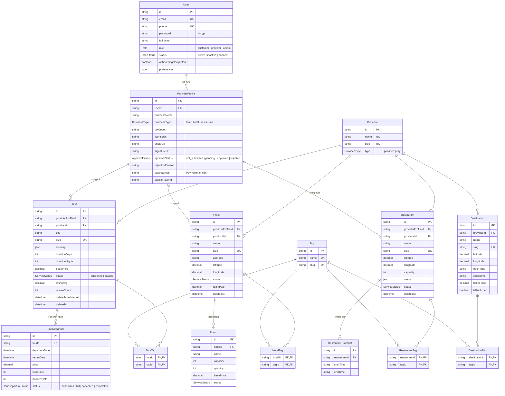
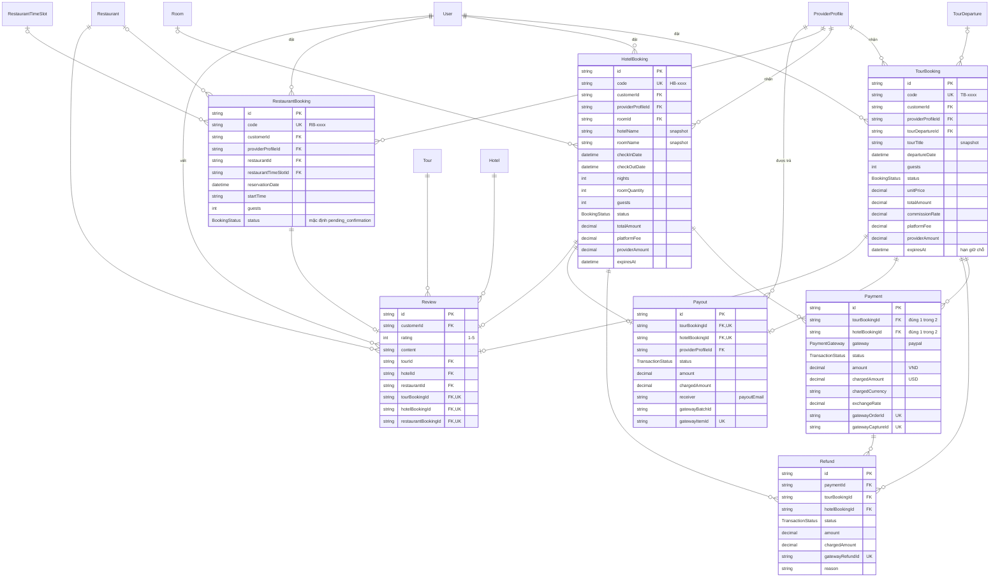
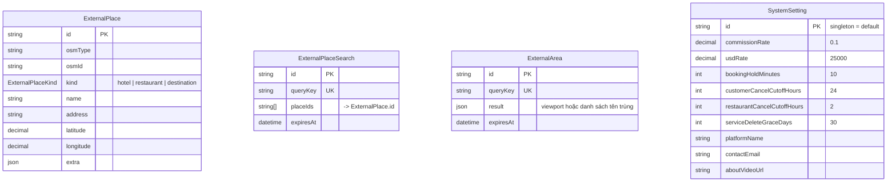

# Sơ đồ cơ sở dữ liệu

PostgreSQL, quản lý bằng Prisma (`prisma/schema.prisma`). Sơ đồ chia thành 3 nhóm để dễ đọc; các bảng xuất hiện ở nhiều nhóm là cùng một bảng.

## 1. Người dùng, nhà cung cấp và dịch vụ

## 2. Đặt chỗ, thanh toán và đánh giá

## 3. Bảng độc lập (cache AI và cấu hình)

## Ghi chú thiết kế

- **Snapshot dữ liệu đơn:** đơn đặt lưu lại tên dịch vụ, giá, tỷ lệ hoa hồng tại thời điểm đặt. Khi dịch vụ bị sửa hoặc xóa, khóa ngoại tới `TourDeparture` / `Room` / `Restaurant` chuyển thành `NULL` (`onDelete: SetNull`), đơn vẫn còn nguyên.
- **Ràng buộc "đúng một trong nhiều":** `Payment` và `Refund` gắn với đúng một trong `TourBooking` / `HotelBooking`; `Review` gắn với đúng một trong `Tour` / `Hotel` / `Restaurant`. Các ràng buộc này là `CHECK` trong migration.
- **Một đơn – một đánh giá – một payout:** khóa `UNIQUE` trên `Review.*BookingId` và `Payout.*BookingId`.
- **Tiền tệ:** giá lưu bằng VND; PayPal không hỗ trợ VND nên `Payment` / `Refund` / `Payout` lưu thêm số tiền thực thu bằng USD (`chargedAmount`, `chargedCurrency`, `exchangeRate`).
- **Xóa mềm dịch vụ:** nhà cung cấp xóa tour/khách sạn/nhà hàng → đặt `deleteScheduledAt`; Vercel Cron đặt `deletedAt` khi hết thời gian ân hạn (`serviceDeleteGraceDays`).
- **Nhà hàng không thanh toán trước:** `RestaurantBooking` không có cột tiền và không liên kết `Payment` / `Payout`.
- **Một user nhiều hồ sơ:** mỗi nhà cung cấp có tối đa một hồ sơ cho mỗi loại hình (`@@unique([userId, businessType])`).
