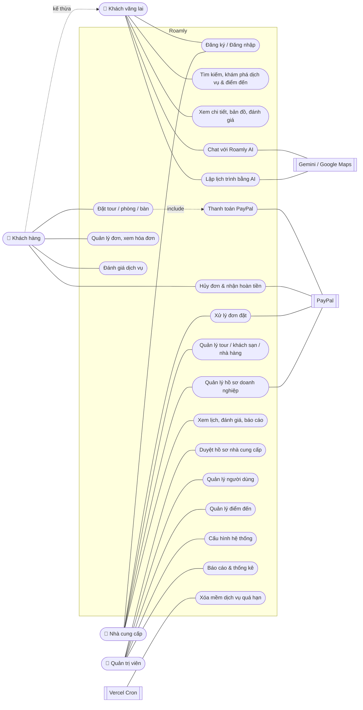
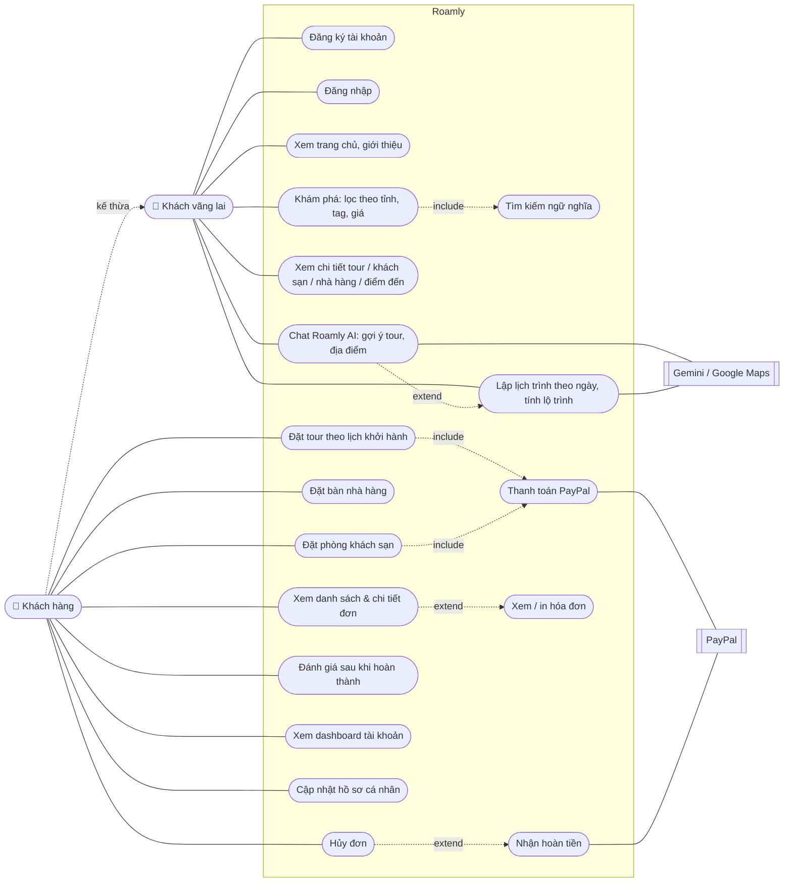
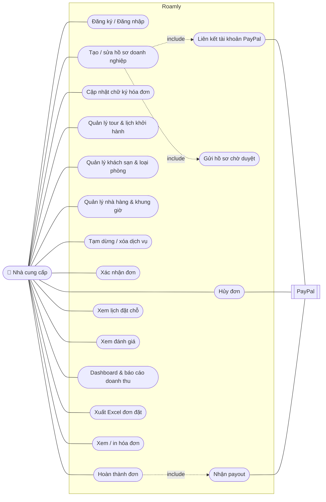
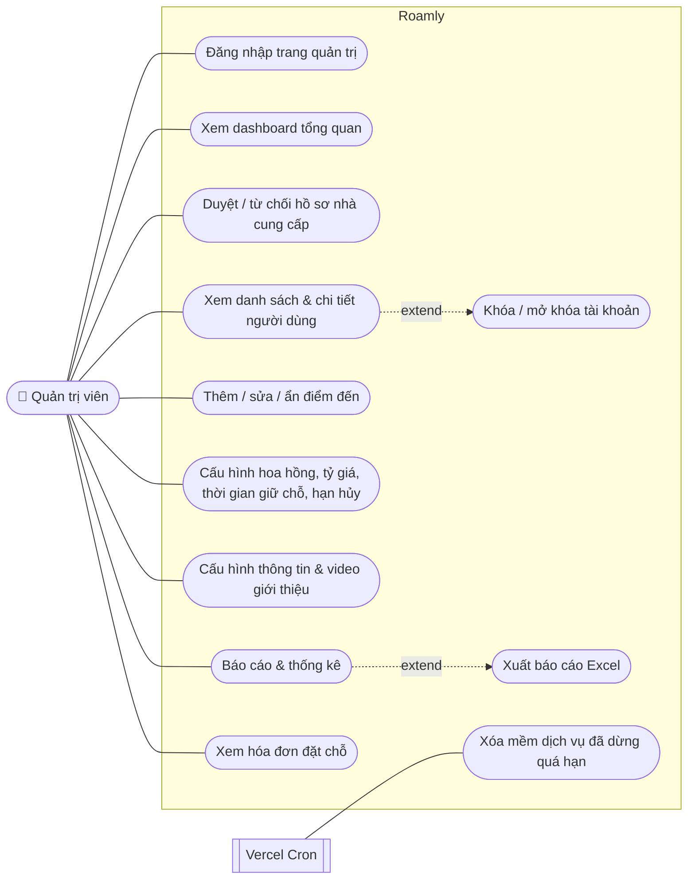

# Sơ đồ Use Case

## Tác nhân

| Tác nhân | Mô tả |
|---|---|
| **Khách vãng lai** | Người chưa đăng nhập: xem, tìm kiếm, chat với AI, lập lịch trình. |
| **Khách hàng** (`customer`) | Kế thừa khách vãng lai; đặt chỗ, thanh toán, quản lý đơn, đánh giá. |
| **Nhà cung cấp** (`provider`) | Doanh nghiệp tour / khách sạn / nhà hàng; quản lý hồ sơ, dịch vụ, đơn đặt. |
| **Quản trị viên** (`admin`) | Vận hành sàn: duyệt hồ sơ, quản lý người dùng, điểm đến, cấu hình, báo cáo. |
| PayPal | Hệ thống ngoài: thanh toán, hoàn tiền, payout, webhook. |
| Gemini (Vertex AI), Google Maps | Hệ thống ngoài: mô hình AI, tìm địa điểm, tính lộ trình. |
| Vercel Cron | Hệ thống ngoài: xóa mềm dịch vụ đã dừng quá hạn. |

## Tổng quan

## Khách vãng lai & Khách hàng

## Nhà cung cấp

## Quản trị viên

## Đặc tả tóm tắt các use case chính

| Use case | Tác nhân | Tiền điều kiện | Luồng chính | Hậu điều kiện |
|---|---|---|---|---|
| Đặt tour / phòng | Khách hàng | Đã đăng nhập; còn chỗ / còn phòng | Chọn lịch / ngày → nhập thông tin liên hệ → tạo đơn `pending_payment` giữ chỗ → chuyển sang PayPal | Đơn được giữ trong `bookingHoldMinutes` phút |
| Thanh toán PayPal | Khách hàng, PayPal | Đơn `pending_payment` chưa hết hạn | Quy đổi VND → USD → PayPal duyệt → capture → ghi `Payment` | Đơn `paid`; quá hạn thì `expired` và trả chỗ |
| Đặt bàn | Khách hàng | Đã đăng nhập; khung giờ còn sức chứa | Chọn ngày, khung giờ, số khách → tạo đơn | Đơn `pending_confirmation` chờ nhà hàng xác nhận |
| Hủy đơn | Khách hàng / Nhà cung cấp | Đơn `paid` / `confirmed` (khách: trước hạn hủy) | Cập nhật `cancelled` → tạo `Refund` → hoàn tiền qua PayPal | Khách nhận lại tiền, chỗ được trả lại |
| Hoàn thành đơn | Nhà cung cấp | Đơn `confirmed`, dịch vụ đã diễn ra | Cập nhật `completed` → tạo `Payout` (sau khi trừ hoa hồng) | Nhà cung cấp nhận tiền về PayPal; khách được đánh giá |
| Đánh giá | Khách hàng | Đơn `completed`, chưa đánh giá | Chấm 1–5 sao, viết nội dung | Cập nhật `ratingAvg`, `reviewCount` của dịch vụ |
| Duyệt hồ sơ | Quản trị viên | Hồ sơ ở trạng thái `pending` | Xem giấy phép, thông tin → duyệt hoặc từ chối kèm lý do | `approved`: được đăng dịch vụ; `rejected`: sửa và gửi lại |
| Chat Roamly AI | Khách vãng lai | — | Gửi câu hỏi → AI gọi tool tìm tour / địa điểm / web → trả lời kèm thẻ dịch vụ | Có thể chuyển sang lập lịch trình |
| Lập lịch trình | Khách vãng lai | — | Mô tả chuyến đi → AI hỏi thêm, tìm địa điểm → tạo lịch trình theo ngày → tính lộ trình | Lịch trình lưu trong trình duyệt, có thể chỉnh tay |
