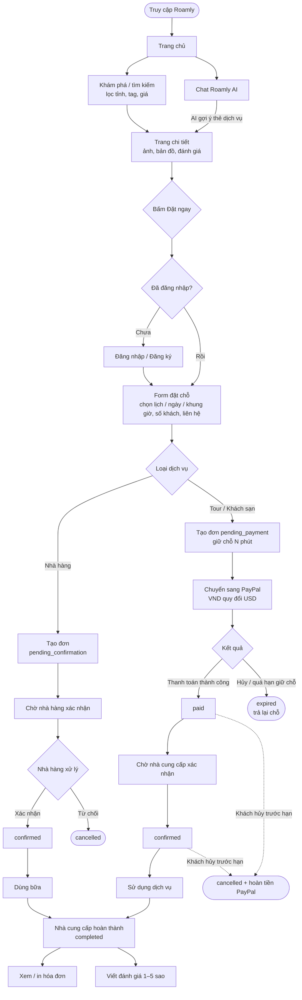
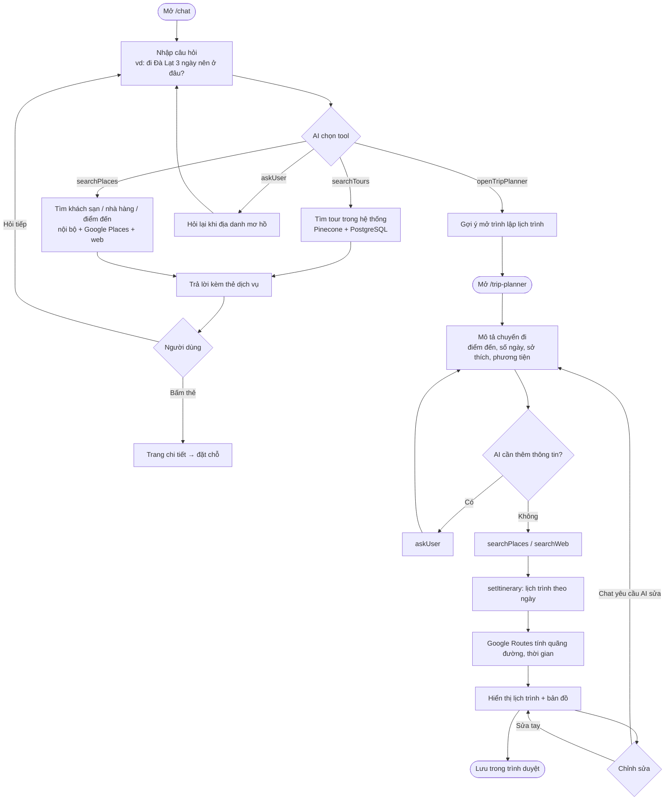
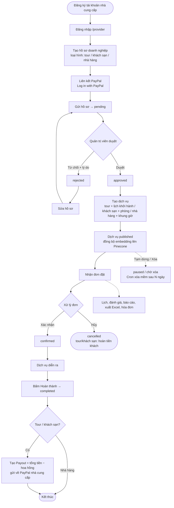
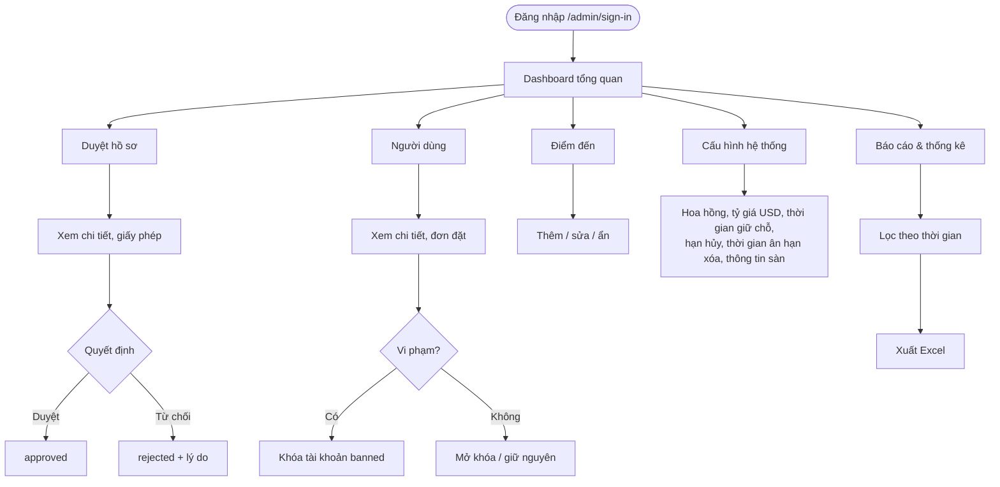
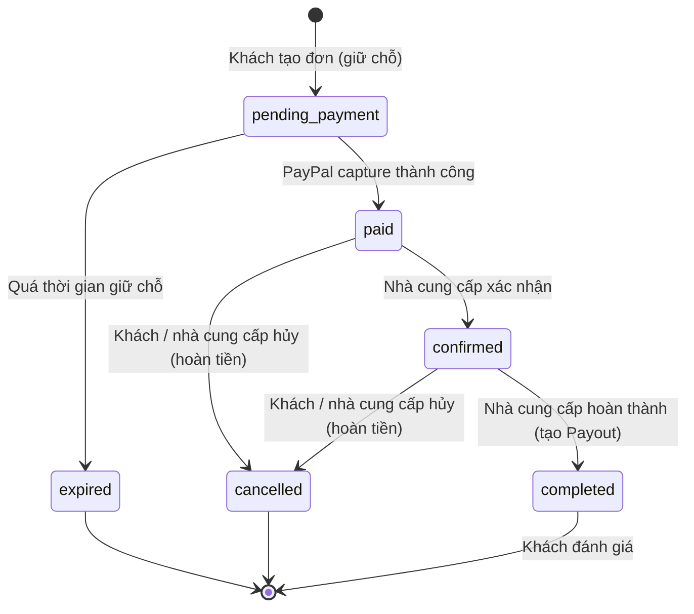
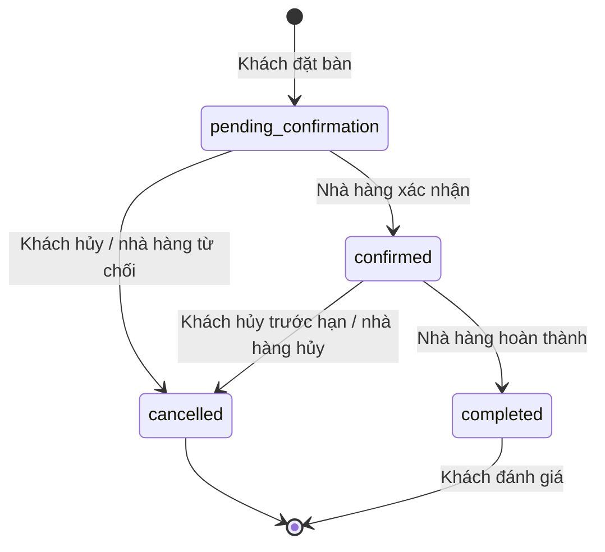
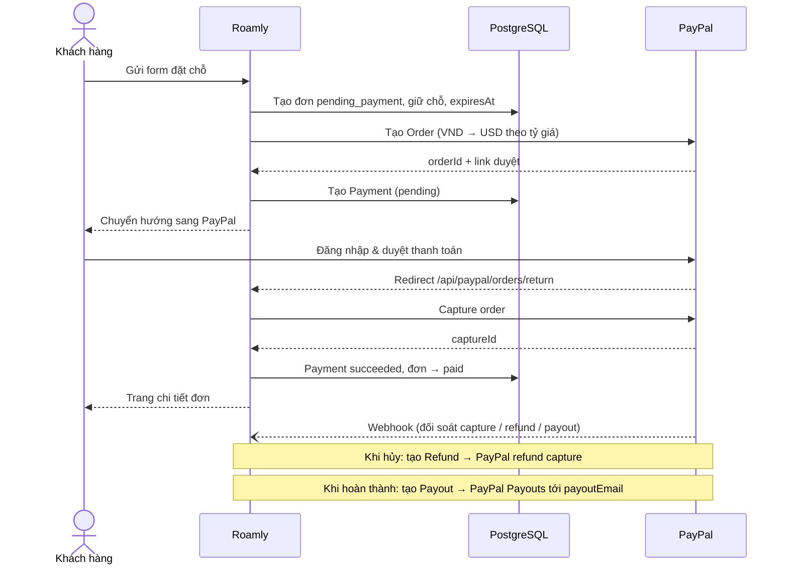

# User Flow

## 1. Khách hàng: tìm kiếm → đặt chỗ → thanh toán → đánh giá

## 2. Khách: chat AI và lập lịch trình

## 3. Nhà cung cấp: đăng ký → được duyệt → bán dịch vụ → nhận tiền

## 4. Quản trị viên

## 5. Vòng đời trạng thái đơn đặt

### Tour / Khách sạn (có thanh toán)

### Nhà hàng (không thanh toán trước)

## 6. Luồng thanh toán PayPal (tour / khách sạn)

